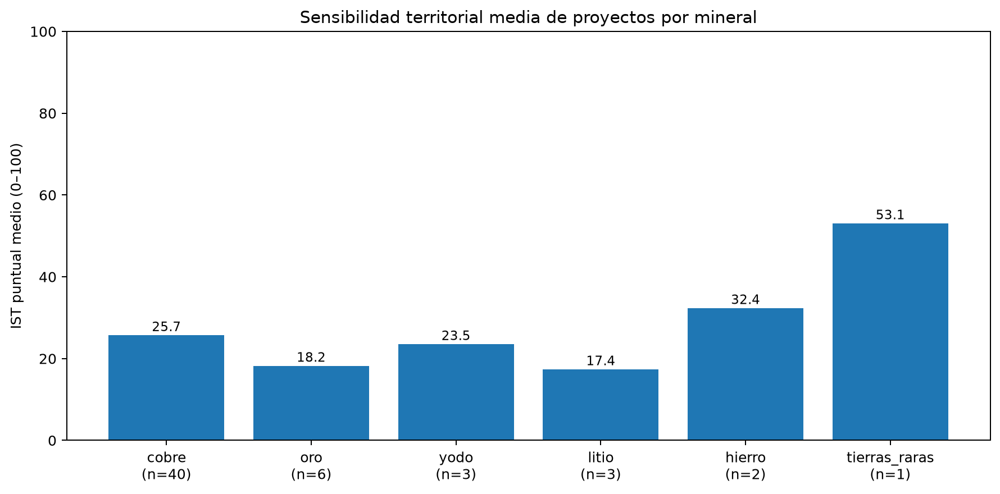
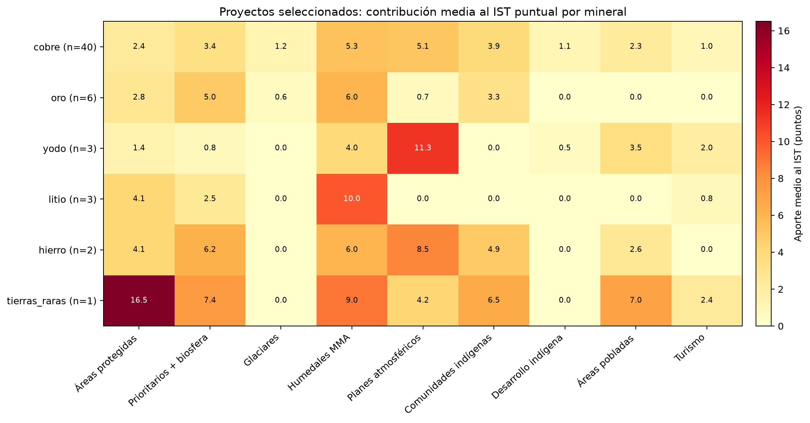

# Resultados por mineral — proyectos seleccionados ENMC

> Análisis descriptivo: las localizaciones de proyectos se representan mediante puntos. El IST no mide impactos comprobados.

## Universo y procedencia
- Proyectos únicos: **55**; filas proyecto–mineral: **55**; minerales: **6**.
- Estado de auditoría independiente del origen: **VALIDADA_CON_INTEGRACION_HISTORICA_55_DE_57**.
- COCHILCO es la Corporación Chilena del Cobre; su denominación institucional no implica que una cartera evaluada contenga únicamente cobre.
- Dos exclusiones del universo original (carbonato y yeso) se documentan únicamente si existe la tabla original de auditoría.

## IST puntual medio según mineral

| Mineral | Proyectos | IST medio | Mediana |
|---|---:|---:|---:|
| cobre | 40 | 25.72 | 21.88 |
| oro | 6 | 18.24 | 17.44 |
| yodo | 3 | 23.53 | 27.68 |
| litio | 3 | 17.38 | 18.07 |
| hierro | 2 | 32.35 | 32.35 |
| tierras_raras | 1 | 53.08 | 53.08 |

## Gráficos

## Tablas y controles

- [Matriz por mineral](../../reports/enmc/72_resumen_mineral_ist_componentes.csv)
- [Matriz región–mineral](../../reports/enmc/72_resumen_region_mineral_ist.csv)
- [Matriz por proyecto](../../reports/enmc/72_matriz_proyecto_mineral_region_componentes.csv)
- [Control y procedencia](../../reports/enmc/72_control_analisis_mineral.json)

## Limitaciones

- Los índices describen proximidad geométrica a elementos sensibles; no son una evaluación de impacto ambiental.
- El índice OA debe interpretarse como huellas candidatas registradas, no como operaciones vigentes confirmadas.
- Las concesiones no informan un mineral identificable; no atribuir superficies concesionadas a un mineral.
- Los grupos con pocos proyectos carecen de robustez inferencial y solo se presentan descriptivamente.
- Las geometrías de proyectos son puntos y las áreas de influencia hipotéticas no equivalen a superficies de intervención.
- Los registros multiminéricos, si existen, se cuentan por cada mineral asociado; el universo único permanece sin duplicación.
