# Informe integral — Atlas de minerales críticos y sensibilidad territorial

> **Actualizado desde outputs locales:** 2026-11-18 12:57 UTC. 
> **Alcance:** 343 comunas, 16 regiones, 347 unidades IST, 11 capas para 9 componentes. Los indicadores describen proximidad y coincidencias espaciales, no impacto ambiental efectivo.

## 1. Resumen ejecutivo

Se analizaron **292 huellas OA candidatas**, **55 proyectos localizados en puntos** y **83.522 concesiones constituidas**. El IST **homologado por localización puntual** alcanza **28,29** puntos en OA y **25,07** en proyectos. La asignación regional está resuelta para 347/347 registros. La geometría OA describe huella registrada, no necesariamente una faena actualmente operativa. Los puntos COCHILCO no son superficies verificadas de proyecto.

## 2. Fuentes, unidades y decisiones metodológicas

- **OA:** 292 polígonos; un punto representativo interior para el IST homologado. La huella original permanece para el análisis geométrico complementario.
- **Cartera de proyectos integrada:** 55 localizaciones puntuales y clasificación mineral contrastada con un inventario histórico de 57 registros (55 incluidos, 2 excluidos). COCHILCO es el nombre de la institución, no una clasificación mineral.
- **Concesiones:** 83.522 registros; la unión de concesiones dentro del ámbito cubre 16.239.453,84 ha, sin atributo que permita adjudicarlas a un mineral específico.
- **Ámbito:** 343 comunas (75.256.754,28 ha); EPSG:6933 para áreas y proyección métrica local para distancias.
- **IST:** nueve componentes ponderados y 11 capas. El índice poligonal inicial **no es comparable directamente** con el puntual y se conserva únicamente como resultado complementario.
- **Humedales:** capa nacional MMA/SIMBIO de 117.969 geometrías útiles, sustitución del inventario anterior incompleto.
- **Limitaciones:** estatus operativo OA no verificado individualmente; exactitud espacial de puntos y vigencia de fuentes no auditadas completamente; sin polígonos de intervención futuros verificados.

## 3. IST puntual homologado OA–proyectos

| Fuente | n | IST medio (0–100) | Criterio geométrico |
|---|---|---|---|
| OA | 292 | 28,2920 | Punto representativo interior |
| Proyectos | 55 | 25,0668 | Punto fuente |

Las distancias que superan la ventana de búsqueda de 200 km no se interpretan como distancias exactas; reciben cero cuando están fuera de la banda máxima de puntaje. La diferencia entre las medias es descriptiva y no demuestra un efecto causal ni equivalencia sustantiva entre las poblaciones.

### 3.1 IST regional por fuente

| Región | Fuente | n | IST medio |
|---|---|---|---|
| Región Metropolitana de Santiago | COCHILCO_ENMC | 3 | 67,12 |
| Región Metropolitana de Santiago | OA_ENMC | 8 | 56,66 |
| Región de Antofagasta | COCHILCO_ENMC | 22 | 14,20 |
| Región de Antofagasta | OA_ENMC | 73 | 12,91 |
| Región de Arica y Parinacota | OA_ENMC | 3 | 24,64 |
| Región de Atacama | COCHILCO_ENMC | 17 | 29,80 |
| Región de Atacama | OA_ENMC | 110 | 32,81 |
| Región de Coquimbo | COCHILCO_ENMC | 5 | 23,04 |
| Región de Coquimbo | OA_ENMC | 45 | 29,55 |
| Región de Los Ríos | OA_ENMC | 1 | 35,40 |
| Región de Magallanes y de la Antártica Chilena | OA_ENMC | 5 | 24,33 |
| Región de Tarapacá | COCHILCO_ENMC | 5 | 21,74 |
| Región de Tarapacá | OA_ENMC | 14 | 19,12 |
| Región de Valparaíso | COCHILCO_ENMC | 1 | 27,73 |
| Región de Valparaíso | OA_ENMC | 23 | 41,62 |
| Región del Biobío | COCHILCO_ENMC | 1 | 53,08 |
| Región del Biobío | OA_ENMC | 1 | 50,98 |
| Región del General Carlos Ibañez del Campo | OA_ENMC | 2 | 43,64 |
| Región del Libertador General Bernardo O'Higgins | COCHILCO_ENMC | 1 | 53,60 |
| Región del Libertador General Bernardo O'Higgins | OA_ENMC | 6 | 50,80 |
| Región del Maule | OA_ENMC | 1 | 27,57 |

La unidad OA 162 (Puerto Caldera, 1,18 ha) se asigna administrativamente a Atacama por intersección de su polígono y atributo original; el punto estaba a aproximadamente 3 m del límite digital. No se movió el punto ni se alteró su IST.

## 4. Coincidencia concesional por componente

Los componentes poligonales se expresan como porcentaje de la **superficie de cada capa** que coincide con concesiones. No deben sumarse áreas de componentes diferentes por posibles superposiciones.

| Componente | Superficie sensible (ha) | Coincidente (ha) | Coincidencia superficial |
|---|---|---|---|
| Áreas de desarrollo indígena | 8.380.395,79 | 2.235.855,21 | 26,68 % |
| Planes atmosféricos | 4.302.151,94 | 944.287,41 | 21,95 % |
| Áreas protegidas | 22.600.690,63 | 619.371,46 | 2,74 % |
| Comunidades indígenas (puntos) | 0,00 | 0,00 | No aplica (puntos) |
| Glaciares | 2.096.906,42 | 42.266,79 | 2,02 % |
| Humedales MMA | 5.371.068,18 | 614.734,12 | 11,45 % |
| Áreas pobladas | 236.628,58 | 20.892,64 | 8,83 % |
| Sitios prioritarios + reservas de biosfera | 18.144.108,71 | 2.060.709,08 | 11,36 % |
| Zonas turísticas (polígonos) | 1.891.296,71 | 39.345,72 | 2,08 % |

### 4.1 Componentes representados por puntos

Para comunidades indígenas y atractivos turísticos se cuantifica la proporción de **registros puntuales** localizados dentro de la unión concesional; no corresponde a superficie ni a afectación material.

| Capa | Registros en ámbito | Coincidentes | Porcentaje de registros |
|---|---|---|---|
| CI | 2903 | 110 | 3,79 % |
| AT | 4637 | 533 | 11,49 % |

### 4.2 Matriz regional

Las 144 combinaciones (16 regiones × 9 componentes) se encuentran en [70_overlap_regional_componentes.csv](../../reports/enmc/70_overlap_regional_componentes.csv). El agregado de humedales reproduce 614.734,121 ha de coincidencia con concesiones (11,4453 %); la diferencia de 0,006 ha en superficie sensible frente al paso 58 es de precisión geométrica.

## 5. Análisis por mineral de proyectos

Clasificación contrastada registro a registro con el inventario histórico. Los resultados describen proyectos, no composición mineral de las concesiones.

| Mineral | Proyectos | IST medio | Mediana IST |
|---|---|---|---|
| cobre | 40 | 25,72 | 21,88 |
| oro | 6 | 18,24 | 17,44 |
| yodo | 3 | 23,53 | 27,68 |
| litio | 3 | 17,38 | 18,07 |
| hierro | 2 | 32,35 | 32,35 |
| tierras_raras | 1 | 53,08 | 53,08 |

Los nueve aportes y puntajes de cada grupo, además de la tabla regional por mineral, se adjuntan como CSV. Los grupos con uno, dos o tres proyectos son estrictamente descriptivos.

## 6. Escenarios territoriales por mineral

Entornos hipotéticos **de 10, 25, 50 y 100 km**, unidos por mineral para impedir doble conteo dentro de cada combinación, recortados al ámbito de las 343 comunas e intersectados con concesiones sin atributo mineral. **No son huellas de intervención ni superficies de concesiones del mineral.** Los entornos de diferentes minerales pueden solaparse; sus áreas no deben sumarse.

| Radio (km) | Mineral | n | Entorno dentro de ámbito (ha) | Coincidencia concesional (ha) | % entorno coincidente |
|---|---|---|---|---|---|
| 10 | cobre | 40 | 932.019,86 | 823.002,64 | 88,30 % |
| 10 | hierro | 2 | 62.806,61 | 54.828,53 | 87,30 % |
| 10 | litio | 3 | 82.480,67 | 58.983,47 | 71,51 % |
| 10 | oro | 6 | 188.419,83 | 105.352,64 | 55,91 % |
| 10 | tierras_raras | 1 | 26.856,38 | 9.106,19 | 33,91 % |
| 10 | yodo | 3 | 73.954,66 | 66.367,48 | 89,74 % |
| 25 | cobre | 40 | 4.683.882,77 | 3.219.184,36 | 68,73 % |
| 25 | hierro | 2 | 378.516,16 | 255.341,69 | 67,46 % |
| 25 | litio | 3 | 439.969,76 | 258.329,25 | 58,72 % |
| 25 | oro | 6 | 1.050.215,97 | 556.045,72 | 52,95 % |
| 25 | tierras_raras | 1 | 146.797,17 | 19.347,63 | 13,18 % |
| 25 | yodo | 3 | 420.731,33 | 369.671,03 | 87,86 % |
| 50 | cobre | 40 | 14.056.031,58 | 7.770.458,44 | 55,28 % |
| 50 | hierro | 2 | 1.330.365,50 | 648.952,79 | 48,78 % |
| 50 | litio | 3 | 1.492.077,66 | 672.716,14 | 45,09 % |
| 50 | oro | 6 | 3.040.510,89 | 1.450.309,63 | 47,70 % |
| 50 | tierras_raras | 1 | 466.774,03 | 40.042,83 | 8,58 % |
| 50 | yodo | 3 | 1.625.132,55 | 1.270.078,24 | 78,15 % |
| 100 | cobre | 40 | 27.784.530,26 | 13.310.322,38 | 47,91 % |
| 100 | hierro | 2 | 3.589.637,79 | 1.386.474,38 | 38,62 % |
| 100 | litio | 3 | 3.945.306,32 | 1.704.690,17 | 43,21 % |
| 100 | oro | 6 | 6.239.688,14 | 2.770.876,25 | 44,41 % |
| 100 | tierras_raras | 1 | 1.823.365,85 | 175.768,45 | 9,64 % |
| 100 | yodo | 3 | 4.918.320,01 | 3.645.799,69 | 74,13 % |

El escenario de 100 km representa una exploración de escala territorial, sin justificación como radio de impacto. El porcentaje a 10 km no debe interpretarse como porcentaje de concesiones de un mineral.

## 7. Figuras disponibles para el informe

### 48b_tres_estados_enmc

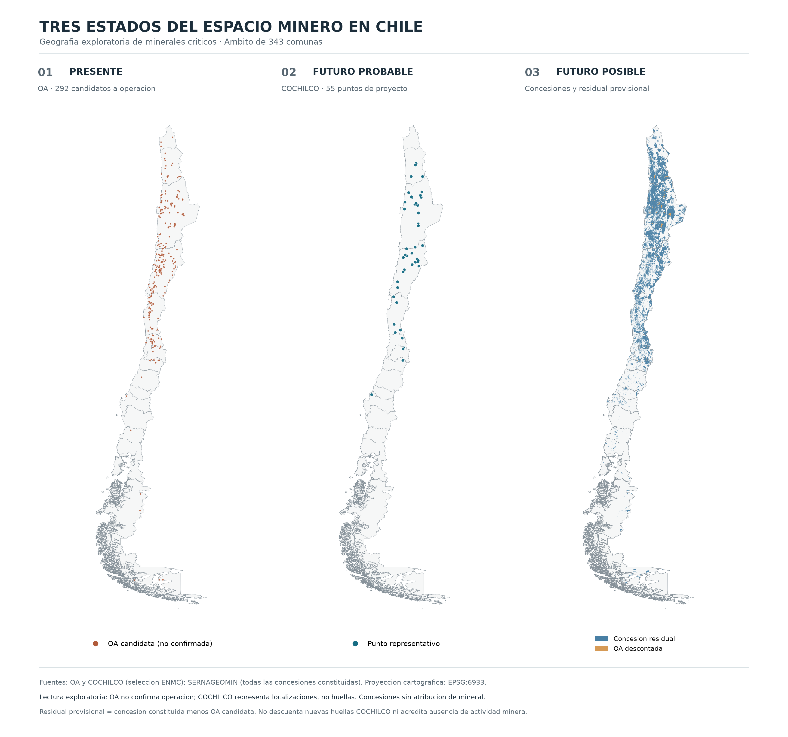

*Tres estados territoriales — 48b_tres_estados_enmc.*

### 49c_detalle_centro_enmc

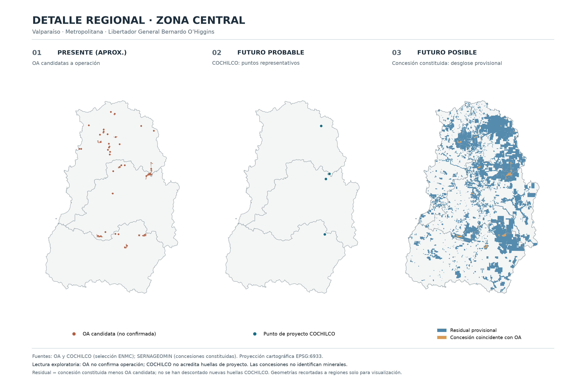

*Detalle territorial regional — 49c_detalle_centro_enmc.*

### 49c_detalle_norte_enmc

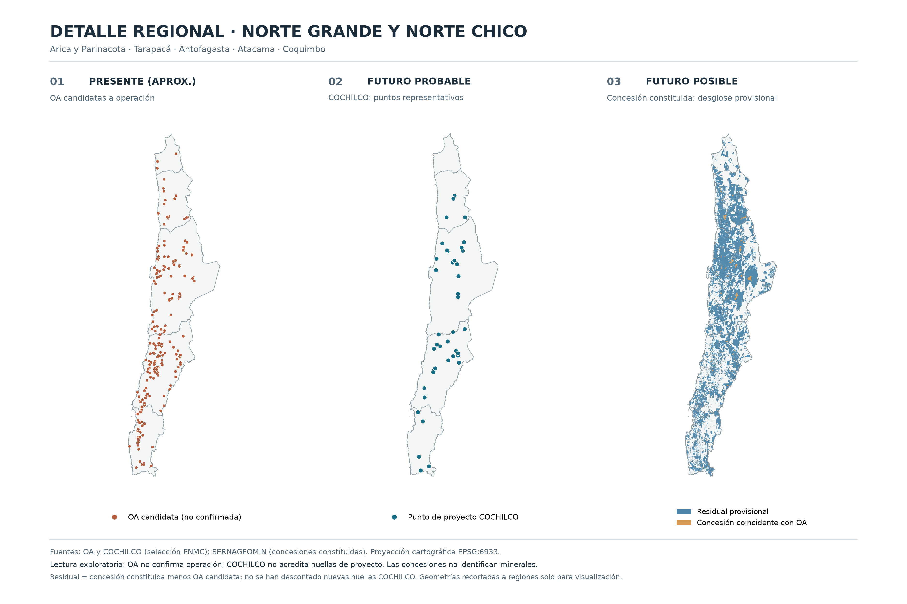

*Detalle territorial regional — 49c_detalle_norte_enmc.*

### 59_balance_humedales_mma_concesiones

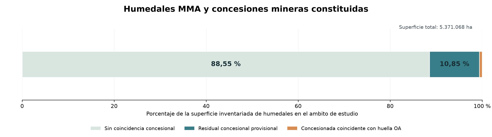

*Balance humedales MMA — 59_balance_humedales_mma_concesiones.*

### 60_ist_humedales_mma_centro

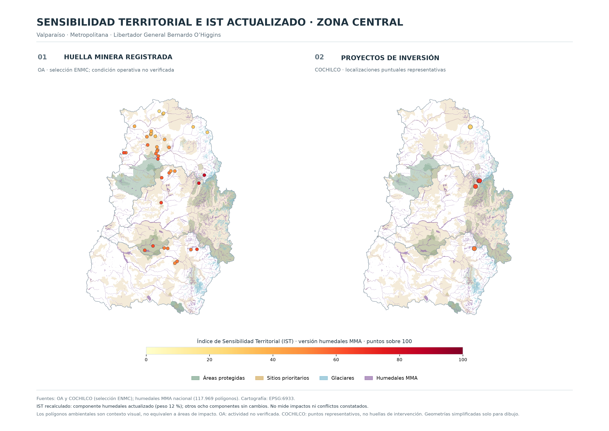

*IST y sensibilidad tras actualización MMA — 60_ist_humedales_mma_centro.*

### 60_ist_humedales_mma_norte

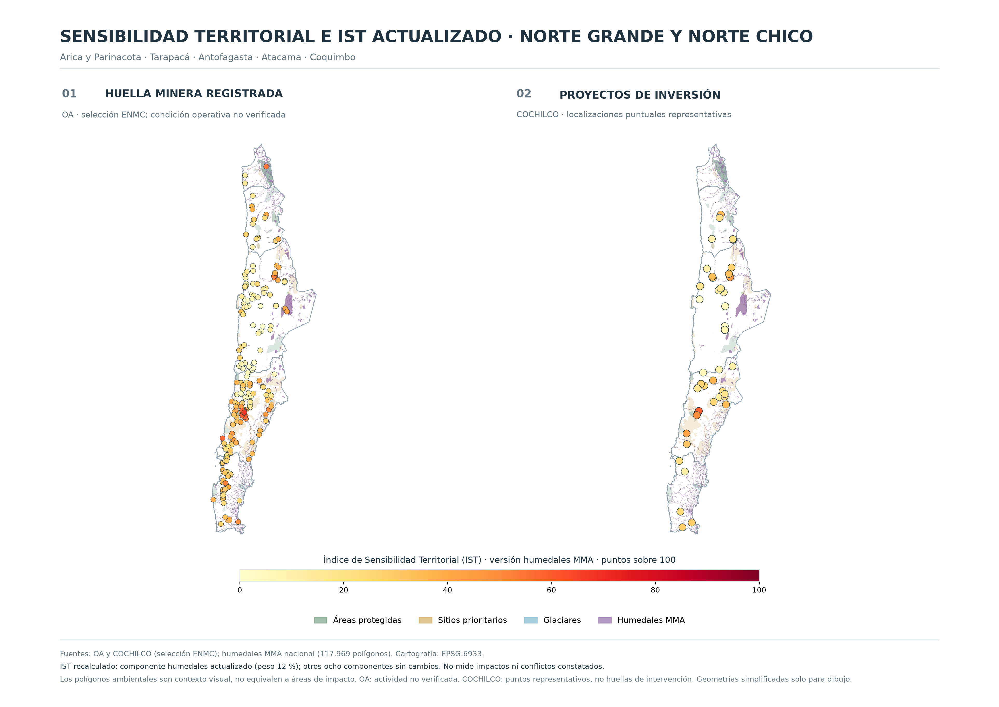

*IST y sensibilidad tras actualización MMA — 60_ist_humedales_mma_norte.*

### 61_overlap_mma_centro

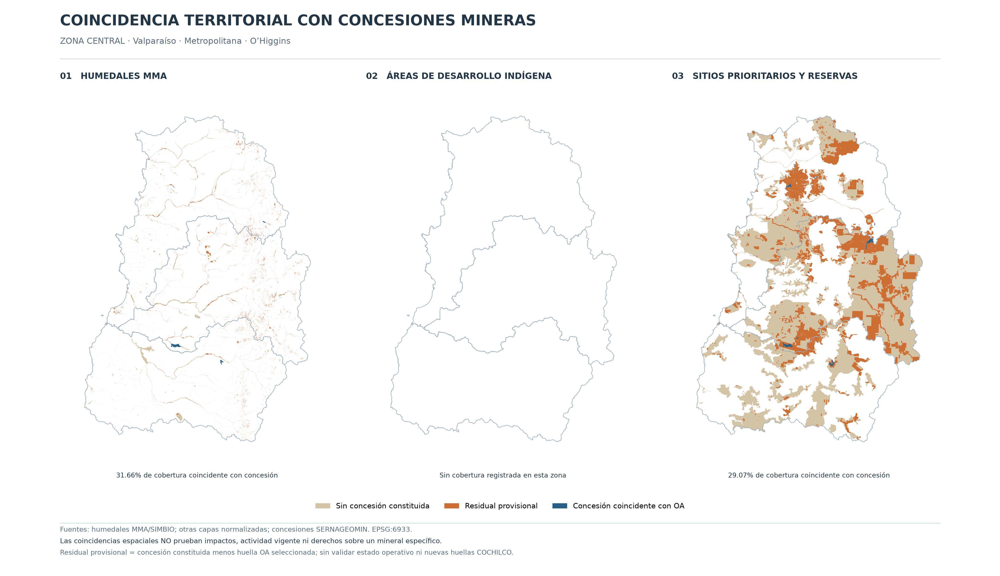

*Coincidencia concesional cartográfica — 61_overlap_mma_centro.*

### 61_overlap_mma_norte

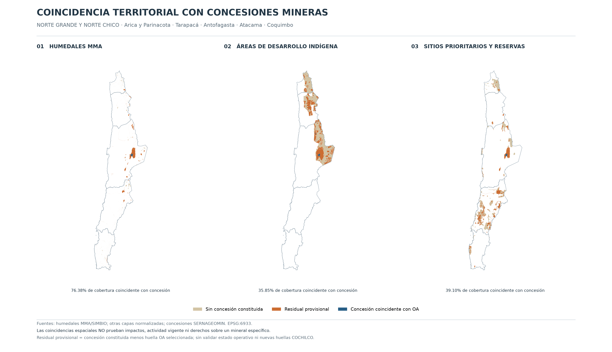

*Coincidencia concesional cartográfica — 61_overlap_mma_norte.*

### 69_aportes_ist_puntual_oa_cochilco

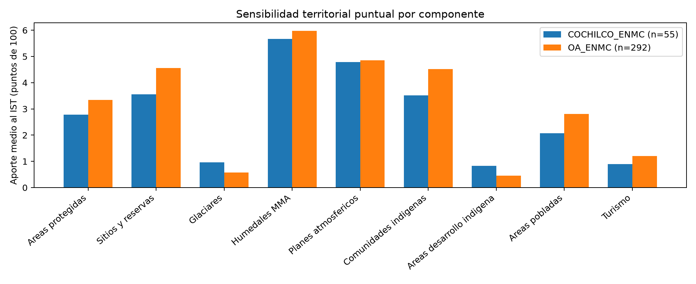

*IST puntual por fuente y componente — 69_aportes_ist_puntual_oa_cochilco.*

### 69_ist_componentes_por_mineral

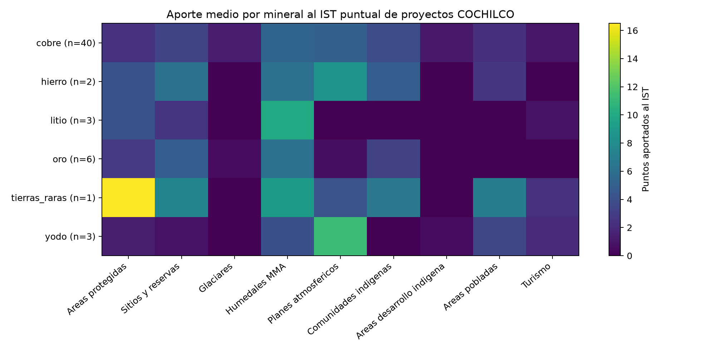

*IST puntual por fuente y componente — 69_ist_componentes_por_mineral.*

### 72_aportes_ist_por_mineral

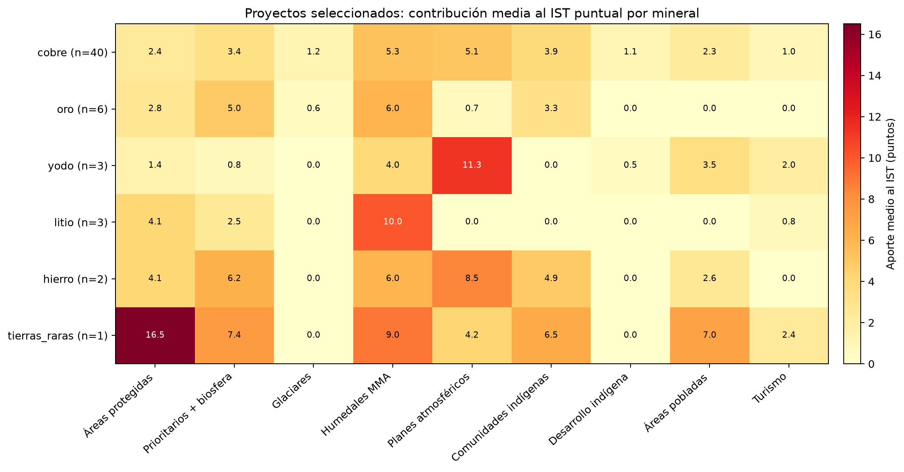

*Comparación de IST por mineral — 72_aportes_ist_por_mineral.*

### 72_ist_medio_por_mineral

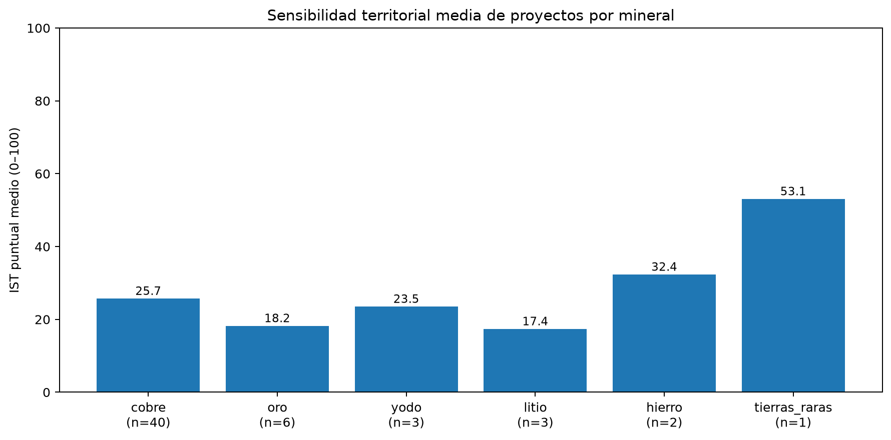

*Comparación de IST por mineral — 72_ist_medio_por_mineral.*

### 73_entornos_por_mineral_radios

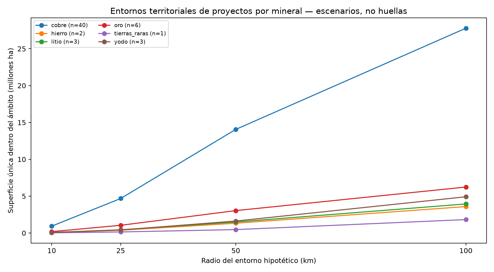

*Escenarios por mineral y radio — 73_entornos_por_mineral_radios.*

## 8. Catálogo de outputs y trazabilidad

Las rutas siguientes se publican con este informe mediante el procedimiento selectivo de staging indicado. Los archivos locales pesados (`data/raw`, `data/processed`, GeoPackage, checkpoints y SVG) no se publican.

### 8.1 Reportes CSV y JSON seleccionados

- [54b_geometrias_no_utilizables.csv](../../reports/enmc/54b_geometrias_no_utilizables.csv)
- [54b_inventario_nacional_humedales_metadatos.json](../../reports/enmc/54b_inventario_nacional_humedales_metadatos.json)
- [55_auditoria_inventario_humedales.json](../../reports/enmc/55_auditoria_inventario_humedales.json)
- [55_cobertura_regional_humedales_comparativa.csv](../../reports/enmc/55_cobertura_regional_humedales_comparativa.csv)
- [56b_control_normalizacion_humedales.json](../../reports/enmc/56b_control_normalizacion_humedales.json)
- [56b_reparaciones_geometricas.csv](../../reports/enmc/56b_reparaciones_geometricas.csv)
- [57_cambios_ist_humedales_mma.csv](../../reports/enmc/57_cambios_ist_humedales_mma.csv)
- [57_control_recalculo_humedales.json](../../reports/enmc/57_control_recalculo_humedales.json)
- [57_ist_enmc_humedales_mma.csv](../../reports/enmc/57_ist_enmc_humedales_mma.csv)
- [57_resumen_cambios_ist_humedales.csv](../../reports/enmc/57_resumen_cambios_ist_humedales.csv)
- [58_overlap_humedales_mma_control.json](../../reports/enmc/58_overlap_humedales_mma_control.json)
- [58_overlap_humedales_mma_resumen.csv](../../reports/enmc/58_overlap_humedales_mma_resumen.csv)
- [58_overlap_humedales_mma_teselas.csv](../../reports/enmc/58_overlap_humedales_mma_teselas.csv)
- [59_control_balance_humedales_mma.json](../../reports/enmc/59_control_balance_humedales_mma.json)
- [60_control_cartografia_ist_mma.csv](../../reports/enmc/60_control_cartografia_ist_mma.csv)
- [61_control_overlap_cartografico_mma.csv](../../reports/enmc/61_control_overlap_cartografico_mma.csv)
- [62_auditoria_ambitos_58_61.csv](../../reports/enmc/62_auditoria_ambitos_58_61.csv)
- [62_auditoria_ambitos_58_61.json](../../reports/enmc/62_auditoria_ambitos_58_61.json)
- [63_conciliacion_humedales_nacional_zonas.csv](../../reports/enmc/63_conciliacion_humedales_nacional_zonas.csv)
- [63_control_conciliacion_humedales.json](../../reports/enmc/63_control_conciliacion_humedales.json)
- [66_control_ist_puntual.json](../../reports/enmc/66_control_ist_puntual.json)
- [66_ist_puntual_homologado.csv](../../reports/enmc/66_ist_puntual_homologado.csv)
- [66_resumen_ist_puntual.csv](../../reports/enmc/66_resumen_ist_puntual.csv)
- [67_proyectos_minerales_formato_largo.csv](../../reports/enmc/67_proyectos_minerales_formato_largo.csv)
- [67_proyectos_minerales_ist_puntual.csv](../../reports/enmc/67_proyectos_minerales_ist_puntual.csv)
- [67_resumen_ist_cochilco_por_region.csv](../../reports/enmc/67_resumen_ist_cochilco_por_region.csv)
- [67_resumen_ist_oa_por_region.csv](../../reports/enmc/67_resumen_ist_oa_por_region.csv)
- [67_resumen_ist_por_mineral.csv](../../reports/enmc/67_resumen_ist_por_mineral.csv)
- [68_control_buffers_cochilco.json](../../reports/enmc/68_control_buffers_cochilco.json)
- [68_escenarios_buffers_cochilco.csv](../../reports/enmc/68_escenarios_buffers_cochilco.csv)
- [69_control_consolidacion_ist.json](../../reports/enmc/69_control_consolidacion_ist.json)
- [69_ist_mineral_por_componente.csv](../../reports/enmc/69_ist_mineral_por_componente.csv)
- [69_ist_puntual_unidades_con_region.csv](../../reports/enmc/69_ist_puntual_unidades_con_region.csv)
- [69_ist_regional_por_fuente_y_componente.csv](../../reports/enmc/69_ist_regional_por_fuente_y_componente.csv)
- [69d_diagnostico_oa_162.json](../../reports/enmc/69d_diagnostico_oa_162.json)
- [69d_distancias_regionales_oa_162.csv](../../reports/enmc/69d_distancias_regionales_oa_162.csv)
- [69f_excepcion_asignacion_regional_oa_162.json](../../reports/enmc/69f_excepcion_asignacion_regional_oa_162.json)
- [70_control_overlap_regional.json](../../reports/enmc/70_control_overlap_regional.json)
- [70_overlap_regional_componentes.csv](../../reports/enmc/70_overlap_regional_componentes.csv)
- [70_resumen_nacional_por_componente.csv](../../reports/enmc/70_resumen_nacional_por_componente.csv)
- [71_control_puntos_sensibles.json](../../reports/enmc/71_control_puntos_sensibles.json)
- [71_puntos_sensibles_coincidencia_regional.csv](../../reports/enmc/71_puntos_sensibles_coincidencia_regional.csv)
- [72_auditoria_procedencia_minerales.csv](../../reports/enmc/72_auditoria_procedencia_minerales.csv)
- [72_control_analisis_mineral.json](../../reports/enmc/72_control_analisis_mineral.json)
- [72_matriz_proyecto_mineral_region_componentes.csv](../../reports/enmc/72_matriz_proyecto_mineral_region_componentes.csv)
- [72_registros_excluidos_auditoria.csv](../../reports/enmc/72_registros_excluidos_auditoria.csv)
- [72_resumen_mineral_ist_componentes.csv](../../reports/enmc/72_resumen_mineral_ist_componentes.csv)
- [72_resumen_region_mineral_ist.csv](../../reports/enmc/72_resumen_region_mineral_ist.csv)
- [73_control_escenarios_por_mineral.json](../../reports/enmc/73_control_escenarios_por_mineral.json)
- [73_escenarios_por_mineral_ambito.csv](../../reports/enmc/73_escenarios_por_mineral_ambito.csv)

### 8.2 Figuras PNG seleccionadas

- [48b_tres_estados_enmc.png](../../outputs/figures/enmc/48b_tres_estados_enmc.png)
- [49c_detalle_centro_enmc.png](../../outputs/figures/enmc/49c_detalle_centro_enmc.png)
- [49c_detalle_norte_enmc.png](../../outputs/figures/enmc/49c_detalle_norte_enmc.png)
- [59_balance_humedales_mma_concesiones.png](../../outputs/figures/enmc/59_balance_humedales_mma_concesiones.png)
- [60_ist_humedales_mma_centro.png](../../outputs/figures/enmc/60_ist_humedales_mma_centro.png)
- [60_ist_humedales_mma_norte.png](../../outputs/figures/enmc/60_ist_humedales_mma_norte.png)
- [61_overlap_mma_centro.png](../../outputs/figures/enmc/61_overlap_mma_centro.png)
- [61_overlap_mma_norte.png](../../outputs/figures/enmc/61_overlap_mma_norte.png)
- [69_aportes_ist_puntual_oa_cochilco.png](../../outputs/figures/enmc/69_aportes_ist_puntual_oa_cochilco.png)
- [69_ist_componentes_por_mineral.png](../../outputs/figures/enmc/69_ist_componentes_por_mineral.png)
- [72_aportes_ist_por_mineral.png](../../outputs/figures/enmc/72_aportes_ist_por_mineral.png)
- [72_ist_medio_por_mineral.png](../../outputs/figures/enmc/72_ist_medio_por_mineral.png)
- [73_entornos_por_mineral_radios.png](../../outputs/figures/enmc/73_entornos_por_mineral_radios.png)

### 8.3 Scripts para reproducir esta etapa

- [65_generar_informe_integral_enmc.py](../../src/65_generar_informe_integral_enmc.py)
- [66_ist_puntual_homologado_enmc.py](../../src/66_ist_puntual_homologado_enmc.py)
- [67_matriz_proyectos_minerales_ist.py](../../src/67_matriz_proyectos_minerales_ist.py)
- [68_escenarios_buffers_cochilco.py](../../src/68_escenarios_buffers_cochilco.py)
- [69_consolidar_ist_puntual_regional.py](../../src/69_consolidar_ist_puntual_regional.py)
- [69b_consolidar_ist_puntual_regional.py](../../src/69b_consolidar_ist_puntual_regional.py)
- [69c_consolidar_ist_puntual_regional.py](../../src/69c_consolidar_ist_puntual_regional.py)
- [69d_diagnosticar_oa_sin_region.py](../../src/69d_diagnosticar_oa_sin_region.py)
- [69e_diagnosticar_oa_sin_region.py](../../src/69e_diagnosticar_oa_sin_region.py)
- [69f_consolidar_ist_puntual_regional.py](../../src/69f_consolidar_ist_puntual_regional.py)
- [70_overlap_regional_componentes_enmc.py](../../src/70_overlap_regional_componentes_enmc.py)
- [71_auditar_puntos_sensibles_concesiones.py](../../src/71_auditar_puntos_sensibles_concesiones.py)
- [72_auditar_y_consolidar_minerales_enmc.py](../../src/72_auditar_y_consolidar_minerales_enmc.py)
- [73_entornos_por_mineral_enmc.py](../../src/73_entornos_por_mineral_enmc.py)
- [74_actualizar_informe_integral_enmc.py](../../src/74_actualizar_informe_integral_enmc.py)

## 9. Controles de calidad y estado de validación

- IST puntual: 347/347 unidades; 292 OA y 55 proyectos; nueve aportes verificables por registro.
- Regionalización: 347/347 asignadas; una excepción costera documentada para OA 162.
- Coincidencia poligonal: 144/144 combinaciones calculadas, recorte por región y ámbito.
- Humedales MMA: coincidencia nacional contrastada con paso 58.
- Puntos sensibles: 2.903 comunidades indígenas y 4.637 atractivos turísticos, con indicadores de registros separados de los de superficie.
- Clasificación mineral: 55/55 etiquetas auditadas contra inventario histórico.
- Entornos: 24/24 escenarios completos, con uniones por mineral y recorte territorial.

## 10. Limitaciones de interpretación

1. Un derecho concesional no equivale a ejecución minera ni implica una presión ambiental efectiva.
2. Los porcentajes de registros puntuales no son equivalentes a los porcentajes de superficie.
3. Las concesiones no identifican mineral: su coincidencia con entornos etiquetados no habilita atribución mineral.
4. Los entornos circulares son supuestos geométricos exploratorios; no representan impacto, proyecto ni construcción futura.
5. Las 292 huellas OA son candidatas y pueden contener infraestructuras auxiliares o no operativas.
6. La cobertura y vigencia temática de las otras ocho componentes sensibles no se ha auditado exhaustivamente.
7. Las distancias sin candidato a menos de 200 km no proporcionan una distancia mínima exacta.
8. El análisis por mineral utiliza tamaños muestrales desiguales. No se realizan pruebas inferenciales.

## 11. Pendientes para el artículo

- Seleccionar y justificar una escala exploratoria principal de buffers, si se desea incluirla.
- Revisar visualmente las figuras 69, 72 y 73 antes de elegir las imágenes del manuscrito.
- Completar la verificación temática del universo OA y la validación de proyectos con geometrías de fuente primaria cuando existan.
- Si se necesitan coincidencias entre **buffers** y capas sensibles, ejecutar ese cruce aparte; no está contenido en el paso 73.

---

*Generado automáticamente por `src/74_actualizar_informe_integral_enmc.py` a partir de outputs disponibles en el repositorio de trabajo.*
