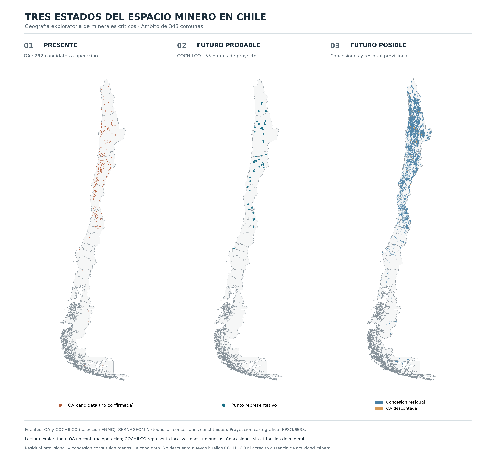
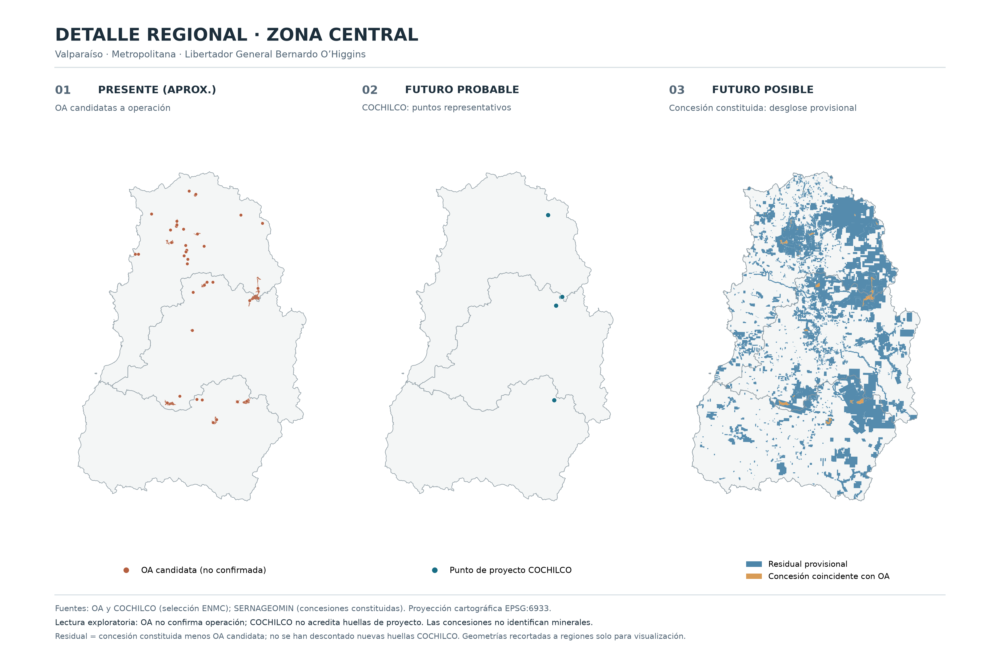
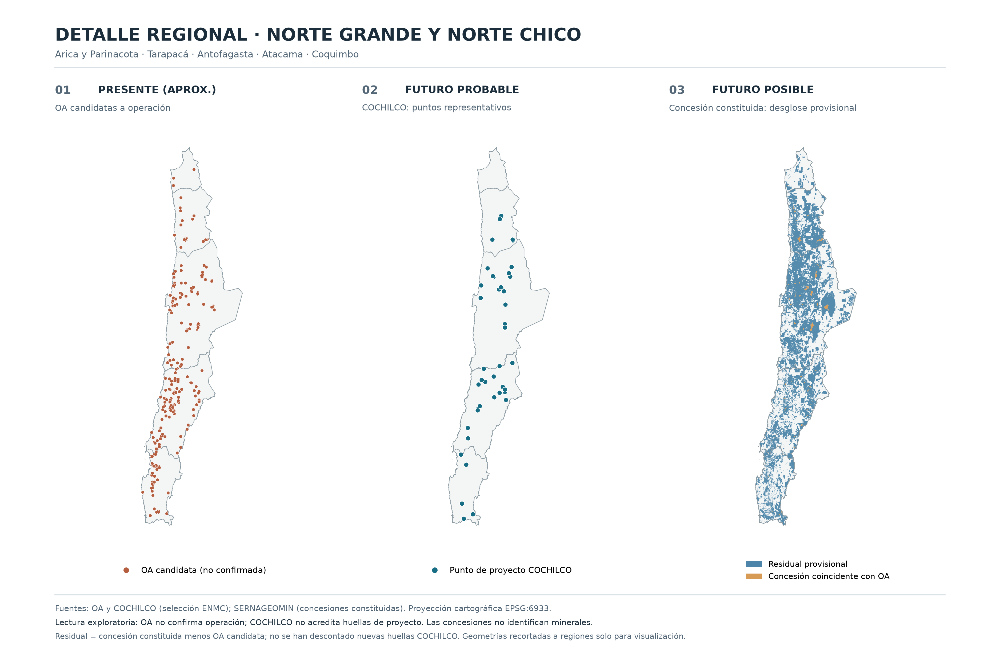
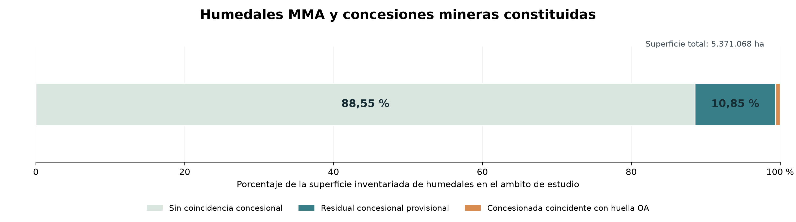
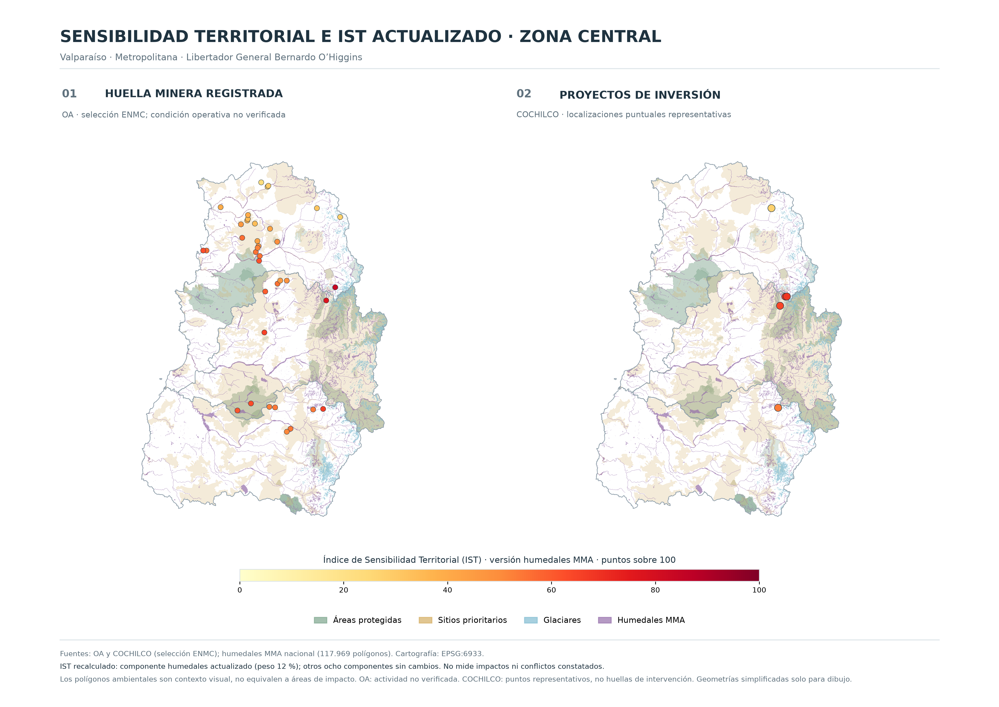
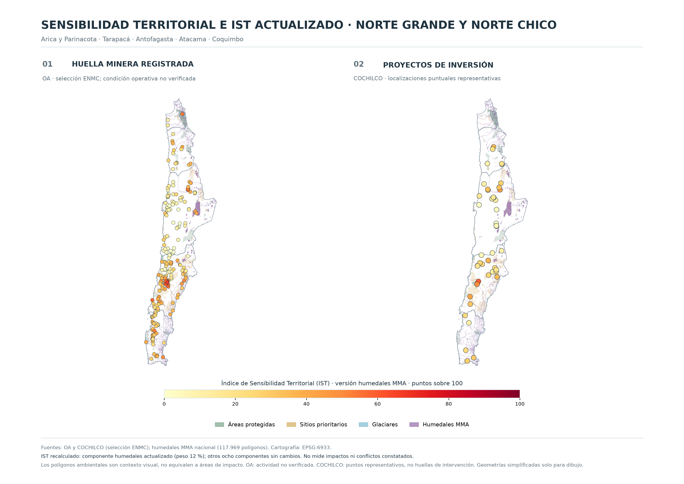
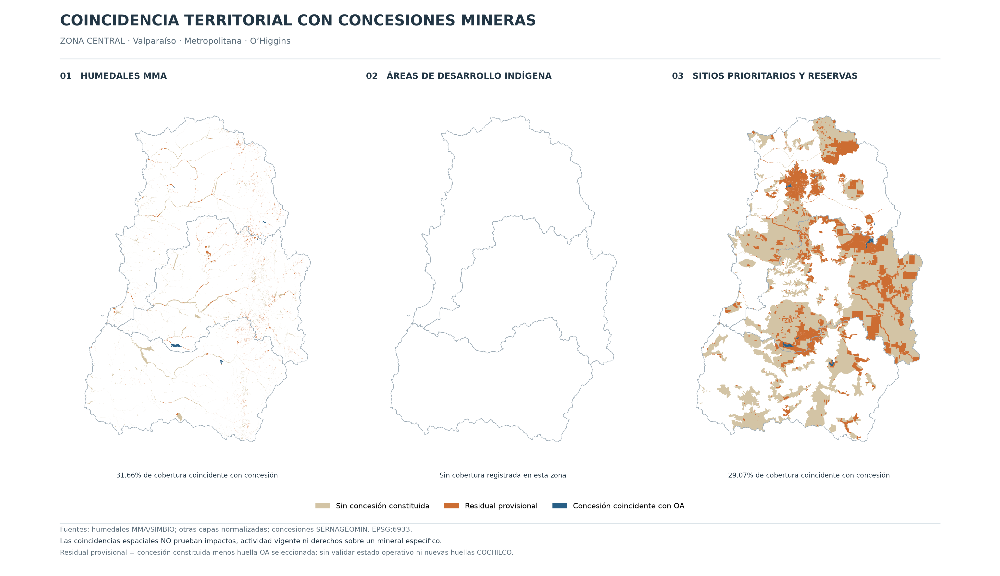
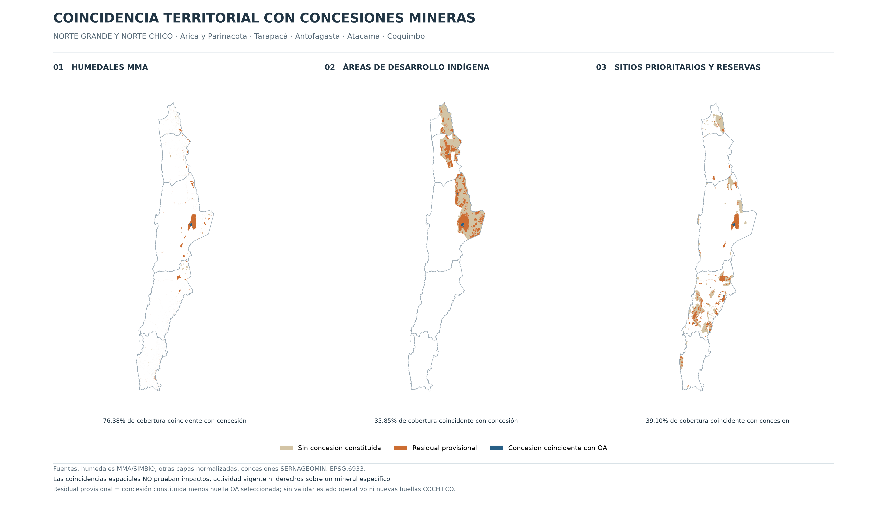

# Informe integral de resultados y outputs — Minerales críticos en Chile

> **Versión del repositorio:** `5320655` · Generado: 2026-11-08 02:23 UTC.
> **Naturaleza:** informe técnico reproducible. Los indicadores no acreditan explotación activa, impacto ambiental ni mineral asociado a cada concesión.

## 1. Resumen ejecutivo

El análisis reúne la huella minera registrada seleccionada de OA (292 unidades no verificadas individualmente como activas), 55 localizaciones puntuales de proyectos COCHILCO y concesiones mineras constituidas sin atributo mineral. Se construyó y actualizó el Índice de Sensibilidad Territorial (IST) y se evaluó la coincidencia espacial entre coberturas sensibles y concesiones dentro del ámbito común de 343 comunas (75.256.754,28 ha).

### 1.1 IST: comparación antes/después del inventario nacional MMA

| Fuente | n | Unidades modificadas | IST previo | IST actualizado | Δ medio | Δ máximo |
| --- | --- | --- | --- | --- | --- | --- |
| COCHILCO_ENMC | 55 | 42 | 20,212 | 25,067 | 4,855 | 12,00 |
| OA_ENMC | 292 | 224 | 24,930 | 31,053 | 6,123 | 12,00 |

**Total:** 266 de 347 entidades modificadas por la sustitución del componente de humedales (peso 12 %).

### 1.2 Coincidencia concesional con humedales MMA

| Partición espacial excluyente | Superficie (ha) | % del total |
| --- | --- | --- |
| Sin coincidencia concesional | 4.756.334,07 | 88,55 |
| Residual concesional provisional | 582.505,18 | 10,85 |
| Concesión coincidente con huella OA seleccionada | 32.228,94 | 0,60 |
| **Total de humedales en 343 comunas** | **5.371.068,19** | **100,00** |

La coincidencia total con concesiones constituidas es **614.734,12 ha**, equivalente al **11,45 %** de la cobertura inventariada en el ámbito. El residual y la coincidencia OA son particiones de esa coincidencia, no concesiones adicionales.

## 2. Objetivo, universo y delimitación

Se comparan tres estados territoriales distintos, que no constituyen clases equivalentes de actividad minera:

1. **Huella minera registrada (OA, selección ENMC):** polígonos de 292 unidades físicas candidatas; operación vigente no verificada individualmente.
2. **Proyectos anunciados (COCHILCO):** 55 puntos representativos; no se consideran polígonos de intervención ni superficies nuevas verificadas.
3. **Derechos mineros constituidos:** concesiones de exploración y explotación sin atributo de mineral crítico; el residual se obtiene al descontar huellas OA seleccionadas y es provisional.

El ámbito común corresponde a **343 comunas**, no necesariamente a la totalidad de la superficie nacional. Las áreas se calculan en **EPSG:6933**. Se emplean geometrías no simplificadas para medir; la simplificación se reserva exclusivamente para cartografía.

## 3. Fuentes, cobertura e integridad

| Insumo | Uso | Precaución |
| --- | --- | --- |
| OA-2-Articulo | Huella minera registrada y validación inicial IST | Actividad vigente por unidad no verificada |
| COCHILCO | Localización de proyectos | Puntos, no polígonos de impacto |
| SERNAGEOMIN (concesiones constituidas) | Coincidencia concesional y residual | Sin atributo de mineral crítico |
| MMA/SIMBIO (humedales) | Componente HU y superposición | Auditoría temática/temporal aún pendiente |
| Otras diez capas ambientales y sociales | Ocho componentes adicionales del IST | Cobertura temática y vigencia por verificar |

### 3.1 Cambio de inventario de humedales

La capa inicial tenía 4.801 geometrías con presencia en 3/16 regiones. Se descargó la capa oficial de [MMA/SIMBIO](https://arcgis.mma.gob.cl/server/rest/services/SIMBIO/SIMBIO_HUMEDALES/FeatureServer/0) con 117.983 identificadores, de los cuales 117.969 poseen geometría utilizable y 14 se excluyeron con trazabilidad individual. Tras reproyección a EPSG:6933 se documentó una reparación topológica. La capa final tiene presencia en 16/16 regiones.

La fuente previa permanece preservada a efectos de auditoría. El 35,66 % anteriormente atribuido a humedales se calculó sobre esa cobertura geográfica limitada y **no es comparable directamente** con el indicador nuevo.

#### Comparación regional del inventario

| fuente | region | n_geometrias_intersectan | n_geometrias_fuente |
| --- | --- | --- | --- |
| MMA_nacional | Región de Tarapacá | 1871 | 117969 |
| MMA_nacional | Región de Antofagasta | 1722 | 117969 |
| MMA_nacional | Región de Atacama | 2033 | 117969 |
| MMA_nacional | Región de Coquimbo | 4027 | 117969 |
| MMA_nacional | Región de Valparaíso | 2831 | 117969 |
| MMA_nacional | Región del Libertador General Bernardo O'Higgins | 5546 | 117969 |
| MMA_nacional | Región del Maule | 6643 | 117969 |
| MMA_nacional | Región del Biobío | 5660 | 117969 |
| MMA_nacional | Región de La Araucanía | 5393 | 117969 |
| MMA_nacional | Región de Los Lagos | 11631 | 117969 |
| MMA_nacional | Región del General Carlos Ibañez del Campo | 18214 | 117969 |
| MMA_nacional | Región de Magallanes y de la Antártica Chilena | 39935 | 117969 |
| MMA_nacional | Región Metropolitana de Santiago | 4798 | 117969 |
| MMA_nacional | Región de Los Ríos | 3040 | 117969 |
| MMA_nacional | Región de Arica y Parinacota | 1409 | 117969 |
| MMA_nacional | Región de Ñuble | 2976 | 117969 |
| Inventario_anterior | Región de Tarapacá | 0 | 4801 |
| Inventario_anterior | Región de Antofagasta | 0 | 4801 |
| Inventario_anterior | Región de Atacama | 0 | 4801 |
| Inventario_anterior | Región de Coquimbo | 0 | 4801 |
| Inventario_anterior | Región de Valparaíso | 22 | 4801 |
| Inventario_anterior | Región del Libertador General Bernardo O'Higgins | 37 | 4801 |
| Inventario_anterior | Región del Maule | 0 | 4801 |
| Inventario_anterior | Región del Biobío | 0 | 4801 |
| Inventario_anterior | Región de La Araucanía | 0 | 4801 |
| Inventario_anterior | Región de Los Lagos | 0 | 4801 |
| Inventario_anterior | Región del General Carlos Ibañez del Campo | 0 | 4801 |
| Inventario_anterior | Región de Magallanes y de la Antártica Chilena | 0 | 4801 |
| Inventario_anterior | Región Metropolitana de Santiago | 4801 | 4801 |
| Inventario_anterior | Región de Los Ríos | 0 | 4801 |
| Inventario_anterior | Región de Arica y Parinacota | 0 | 4801 |
| Inventario_anterior | Región de Ñuble | 0 | 4801 |

## 4. Metodología del Índice de Sensibilidad Territorial (IST)

El IST cuantifica proximidad ponderada a nueve componentes (derivados de once capas) mediante bandas de distancia. Cada componente recibe 1, 0,75, 0,50, 0,25 o 0 según la distancia a la cobertura más cercana; fuera de su banda máxima, recibe 0. Las distancias se estiman en proyecciones azimutales equidistantes locales por unidad.

| Componente | Peso | Bandas (km) |
| --- | ---: | --- |
| Áreas protegidas | 16,5 % | 1 / 5 / 10 / 25 |
| Sitios prioritarios + reservas de biosfera | 9,9 % | 1 / 5 / 10 / 25 |
| Glaciares | 13,3 % | 0,5 / 2 / 10 / 25 |
| Humedales | 12,0 % | 1 / 5 / 10 / 25 |
| Planes atmosféricos | 17,0 % | 0,5 / 5 / 25 / 50 |
| Comunidades indígenas | 13,1 % | 2 / 10 / 25 / 50 |
| Áreas de desarrollo indígena | 6,5 % | 2 / 10 / 25 / 50 |
| Áreas pobladas | 7,0 % | 2 / 5 / 15 / 30 |
| Atractivos turísticos + ZOIT | 4,7 % | 0,5 / 2 / 5 / 10 |

`IST = 100 × Σ(peso_fraccional × puntaje_componente)`

Al sustituir el inventario MMA se actualiza **solo HU** mediante `IST_57 = IST_43 + 12 × (S_HU_MMA − S_HU_43)`. Los demás componentes conservan los puntajes del cálculo base.

### 4.1 Outputs analíticos del IST

- [43_ist_enmc.csv](../../reports/enmc/43_ist_enmc.csv) — Puntajes, distancias y aportes iniciales por unidad.
- [57_ist_enmc_humedales_mma.csv](../../reports/enmc/57_ist_enmc_humedales_mma.csv) — Puntajes completos actualizados por unidad.
- [57_cambios_ist_humedales_mma.csv](../../reports/enmc/57_cambios_ist_humedales_mma.csv) — Diferencias por unidad.
- [57_resumen_cambios_ist_humedales.csv](../../reports/enmc/57_resumen_cambios_ist_humedales.csv) — Resumen comparativo por fuente.
- [57_control_recalculo_humedales.json](../../reports/enmc/57_control_recalculo_humedales.json) — Control de ponderación, distancia e integridad.

## 5. Coincidencia de humedales y concesiones constituidas

Se recortó el inventario MMA al ámbito de estudio y se calcularon uniones geométricas únicas en 110 teselas disjuntas de 120 km. La intersección con concesiones constituidas se descompuso en residual provisional y coincidencia con la huella OA seleccionada. Las superficies fueron verificadas mediante balances aritméticos.

### 5.1 Conciliación de zonas cartografiadas y total del ámbito

| ambito | humedales_ha | concesionada_ha | residual_ha | oa_ha | sin_concesion_ha | porcentaje_concesionado | origen |
| --- | --- | --- | --- | --- | --- | --- | --- |
| norte | 721330.08788791 | 550933.28423421 | 522005.74522118 | 28927.53901303 | 170396.80320827 | 76.37741632 | 61_interseccion_zonal |
| centro | 107152.06639090 | 33924.52707229 | 30640.88482157 | 3283.64225072 | 73227.53931867 | 31.66017065 | 61_interseccion_zonal |
| norte_y_centro | 828482.15427881 | 584857.81130651 | 552646.63004275 | 32211.18126376 | 243624.34297230 | 70.59389370 | suma_61 |
| resto_no_cartografiado | 4542586.03192372 | 29876.30975099 | 29858.54606401 | 17.76368698 | 4512709.72217273 | 0.65769387 | diferencia_58_menos_61 |
| ambito_343_comunas | 5371068.18620253 | 614734.12105750 | 582505.17610676 | 32228.94495074 | 4756334.06514503 | 11.44528611 | 58_nacional |

Los porcentajes de distintas zonas **no son aditivos** porque tienen denominadores distintos. El resto del ámbito se obtuvo por diferencia aritmética y no equivale a un nuevo análisis espacial independiente.

## 6. Resultados de los demás componentes sensibles

Las tablas históricas de los pasos 40–42 describen coincidencias sobre insumos originales; no se equiparan automáticamente con el resultado actualizado de humedales del paso 58. Estas salidas se catalogan abajo si están publicadas. Los indicadores de otras categorías continúan sujetos a revisión de vigencia, cobertura y alcance.

## 7. Atlas completo de figuras publicadas

Las imágenes corresponden a salidas del procesamiento y se incrustan directamente desde el repositorio. Se incluyen también versiones preliminares únicamente cuando estén efectivamente publicadas.

### 48b tres estados enmc

**Archivo:** [48b_tres_estados_enmc.png](../../outputs/figures/enmc/48b_tres_estados_enmc.png).

### 49c detalle centro enmc

**Archivo:** [49c_detalle_centro_enmc.png](../../outputs/figures/enmc/49c_detalle_centro_enmc.png).

### 49c detalle norte enmc

**Archivo:** [49c_detalle_norte_enmc.png](../../outputs/figures/enmc/49c_detalle_norte_enmc.png).

### 59 balance humedales mma concesiones

**Archivo:** [59_balance_humedales_mma_concesiones.png](../../outputs/figures/enmc/59_balance_humedales_mma_concesiones.png).

### 60 ist humedales mma centro

**Archivo:** [60_ist_humedales_mma_centro.png](../../outputs/figures/enmc/60_ist_humedales_mma_centro.png).

### 60 ist humedales mma norte

**Archivo:** [60_ist_humedales_mma_norte.png](../../outputs/figures/enmc/60_ist_humedales_mma_norte.png).

### 61 overlap mma centro

**Archivo:** [61_overlap_mma_centro.png](../../outputs/figures/enmc/61_overlap_mma_centro.png).

### 61 overlap mma norte

**Archivo:** [61_overlap_mma_norte.png](../../outputs/figures/enmc/61_overlap_mma_norte.png).

## 8. Inventario completo y trazabilidad de outputs publicados

En el commit analizado se identificaron **54 outputs publicados** (8 figuras y mapas, 22 reportes ENMC y 24 tablas adicionales); junto con **72 scripts Python**. Este catálogo se genera con `git ls-files`, por lo que evita enlaces a outputs locales no subidos.

### 8.1 Figuras y mapas

- [48b_tres_estados_enmc.png](../../outputs/figures/enmc/48b_tres_estados_enmc.png)
- [49c_detalle_centro_enmc.png](../../outputs/figures/enmc/49c_detalle_centro_enmc.png)
- [49c_detalle_norte_enmc.png](../../outputs/figures/enmc/49c_detalle_norte_enmc.png)
- [59_balance_humedales_mma_concesiones.png](../../outputs/figures/enmc/59_balance_humedales_mma_concesiones.png)
- [60_ist_humedales_mma_centro.png](../../outputs/figures/enmc/60_ist_humedales_mma_centro.png)
- [60_ist_humedales_mma_norte.png](../../outputs/figures/enmc/60_ist_humedales_mma_norte.png)
- [61_overlap_mma_centro.png](../../outputs/figures/enmc/61_overlap_mma_centro.png)
- [61_overlap_mma_norte.png](../../outputs/figures/enmc/61_overlap_mma_norte.png)

### 8.2 Reportes CSV/JSON ENMC

| Archivo publicado | Filas de datos (CSV) |
| --- | --- |
| [43_ist_enmc.csv](../../reports/enmc/43_ist_enmc.csv) | 347 |
| [43_ist_enmc_resumen.csv](../../reports/enmc/43_ist_enmc_resumen.csv) | 2 |
| [54b_geometrias_no_utilizables.csv](../../reports/enmc/54b_geometrias_no_utilizables.csv) | 14 |
| [54b_inventario_nacional_humedales_metadatos.json](../../reports/enmc/54b_inventario_nacional_humedales_metadatos.json) | — |
| [55_auditoria_inventario_humedales.json](../../reports/enmc/55_auditoria_inventario_humedales.json) | — |
| [55_cobertura_regional_humedales_comparativa.csv](../../reports/enmc/55_cobertura_regional_humedales_comparativa.csv) | 32 |
| [56b_control_normalizacion_humedales.json](../../reports/enmc/56b_control_normalizacion_humedales.json) | — |
| [56b_reparaciones_geometricas.csv](../../reports/enmc/56b_reparaciones_geometricas.csv) | 1 |
| [57_cambios_ist_humedales_mma.csv](../../reports/enmc/57_cambios_ist_humedales_mma.csv) | 347 |
| [57_control_recalculo_humedales.json](../../reports/enmc/57_control_recalculo_humedales.json) | — |
| [57_ist_enmc_humedales_mma.csv](../../reports/enmc/57_ist_enmc_humedales_mma.csv) | 347 |
| [57_resumen_cambios_ist_humedales.csv](../../reports/enmc/57_resumen_cambios_ist_humedales.csv) | 2 |
| [58_overlap_humedales_mma_control.json](../../reports/enmc/58_overlap_humedales_mma_control.json) | — |
| [58_overlap_humedales_mma_resumen.csv](../../reports/enmc/58_overlap_humedales_mma_resumen.csv) | 1 |
| [58_overlap_humedales_mma_teselas.csv](../../reports/enmc/58_overlap_humedales_mma_teselas.csv) | 110 |
| [59_control_balance_humedales_mma.json](../../reports/enmc/59_control_balance_humedales_mma.json) | — |
| [60_control_cartografia_ist_mma.csv](../../reports/enmc/60_control_cartografia_ist_mma.csv) | 2 |
| [61_control_overlap_cartografico_mma.csv](../../reports/enmc/61_control_overlap_cartografico_mma.csv) | 6 |
| [62_auditoria_ambitos_58_61.csv](../../reports/enmc/62_auditoria_ambitos_58_61.csv) | 2 |
| [62_auditoria_ambitos_58_61.json](../../reports/enmc/62_auditoria_ambitos_58_61.json) | — |
| [63_conciliacion_humedales_nacional_zonas.csv](../../reports/enmc/63_conciliacion_humedales_nacional_zonas.csv) | 5 |
| [63_control_conciliacion_humedales.json](../../reports/enmc/63_control_conciliacion_humedales.json) | — |

### 8.3 Tablas adicionales

| Archivo publicado | Filas de datos (CSV) |
| --- | --- |
| [atlas_estadisticas_descriptivas.csv](../../outputs/tables/atlas_estadisticas_descriptivas.csv) | 8 |
| [atlas_top20_cobertura_cobre.csv](../../outputs/tables/atlas_top20_cobertura_cobre.csv) | 20 |
| [atlas_top20_cobertura_integrada.csv](../../outputs/tables/atlas_top20_cobertura_integrada.csv) | 20 |
| [atlas_top20_proyectos_cochilco.csv](../../outputs/tables/atlas_top20_proyectos_cochilco.csv) | 20 |
| [atlas_top20_superficie_cobre.csv](../../outputs/tables/atlas_top20_superficie_cobre.csv) | 20 |
| [atlas_top20_superficie_concesionada.csv](../../outputs/tables/atlas_top20_superficie_concesionada.csv) | 20 |
| [atlas_top20_superficie_oa.csv](../../outputs/tables/atlas_top20_superficie_oa.csv) | 20 |
| [cochilco_minerales_por_region.csv](../../outputs/tables/cochilco_minerales_por_region.csv) | 20 |
| [concesiones_cobertura_comunal.csv](../../outputs/tables/concesiones_cobertura_comunal.csv) | 343 |
| [concesiones_cobertura_regional.csv](../../outputs/tables/concesiones_cobertura_regional.csv) | 16 |
| [indicadores_regionales_visualizacion.csv](../../outputs/tables/indicadores_regionales_visualizacion.csv) | 16 |
| [integracion_oa_concesiones_comunal.csv](../../outputs/tables/integracion_oa_concesiones_comunal.csv) | 343 |
| [integracion_oa_concesiones_regional.csv](../../outputs/tables/integracion_oa_concesiones_regional.csv) | 16 |
| [matriz_cobre_comunal_v1.csv](../../outputs/tables/matriz_cobre_comunal_v1.csv) | 343 |
| [matriz_cobre_regional_v1.csv](../../outputs/tables/matriz_cobre_regional_v1.csv) | 16 |
| [matriz_mineria_comunal_v1.csv](../../outputs/tables/matriz_mineria_comunal_v1.csv) | 343 |
| [matriz_mineria_regional_v1.csv](../../outputs/tables/matriz_mineria_regional_v1.csv) | 16 |
| [oa_cobertura_comunal.csv](../../outputs/tables/oa_cobertura_comunal.csv) | 343 |
| [oa_cobertura_regional.csv](../../outputs/tables/oa_cobertura_regional.csv) | 16 |
| [oa_cobre_por_region.csv](../../outputs/tables/oa_cobre_por_region.csv) | 31 |
| [superficie_comunal_base.csv](../../outputs/tables/superficie_comunal_base.csv) | 345 |
| [superficie_comunal_final.csv](../../outputs/tables/superficie_comunal_final.csv) | 343 |
| [superficie_regional_base.csv](../../outputs/tables/superficie_regional_base.csv) | 16 |
| [superficie_regional_final.csv](../../outputs/tables/superficie_regional_final.csv) | 16 |

### 8.4 Scripts Python

- [01_audit_layers.py](../../src/01_audit_layers.py)
- [02_audit_attributes.py](../../src/02_audit_attributes.py)
- [03_classify_minerals.py](../../src/03_classify_minerals.py)
- [04_audit_admin_boundaries.py](../../src/04_audit_admin_boundaries.py)
- [05_prepare_administrative_units.py](../../src/05_prepare_administrative_units.py)
- [06_consolidate_administrative_units.py](../../src/06_consolidate_administrative_units.py)
- [07_oa_territorial_coverage.py](../../src/07_oa_territorial_coverage.py)
- [08_prepare_concessions.py](../../src/08_prepare_concessions.py)
- [09_diagnose_concessions.py](../../src/09_diagnose_concessions.py)
- [10_finalize_concessions.py](../../src/10_finalize_concessions.py)
- [11_pilot_concessions_antofagasta.py](../../src/11_pilot_concessions_antofagasta.py)
- [12_national_concessions_coverage.py](../../src/12_national_concessions_coverage.py)
- [13_validate_territorial_integrity.py](../../src/13_validate_territorial_integrity.py)
- [14_integrate_oa_concessions.py](../../src/14_integrate_oa_concessions.py)
- [15_integrate_cochilco.py](../../src/15_integrate_cochilco.py)
- [16_generate_regional_maps.py](../../src/16_generate_regional_maps.py)
- [17_generate_comparative_figures.py](../../src/17_generate_comparative_figures.py)
- [18_generate_regional_communal_maps.py](../../src/18_generate_regional_communal_maps.py)
- [19_build_copper_statistics.py](../../src/19_build_copper_statistics.py)
- [20_generate_copper_maps.py](../../src/20_generate_copper_maps.py)
- [21_exploratory_atlas.py](../../src/21_exploratory_atlas.py)
- [22_build_strategic_minerals_module.py](../../src/22_build_strategic_minerals_module.py)
- [23_generate_strategic_minerals_map.py](../../src/23_generate_strategic_minerals_map.py)
- [24_audit_enmc_sources.py](../../src/24_audit_enmc_sources.py)
- [25_audit_enmc_territorial_status.py](../../src/25_audit_enmc_territorial_status.py)
- [26_prepare_enmc_project_review.py](../../src/26_prepare_enmc_project_review.py)
- [27_audit_enmc_project_geometries.py](../../src/27_audit_enmc_project_geometries.py)
- [28_prepare_geometry_review.py](../../src/28_prepare_geometry_review.py)
- [29_build_oa_enmc_candidates.py](../../src/29_build_oa_enmc_candidates.py)
- [30_build_cochilco_enmc.py](../../src/30_build_cochilco_enmc.py)
- [31_audit_concesiones_enmc.py](../../src/31_audit_concesiones_enmc.py)
- [32_build_latente_provisional.py](../../src/32_build_latente_provisional.py)
- [34_reconcile_concessions.py](../../src/34_reconcile_concessions.py)
- [35_clip_enmc_residual.py](../../src/35_clip_enmc_residual.py)
- [36_inventory_sensitivity_layers.py](../../src/36_inventory_sensitivity_layers.py)
- [38_audit_sensitivity_data.py](../../src/38_audit_sensitivity_data.py)
- [39_prepare_sensitivity_layers.py](../../src/39_prepare_sensitivity_layers.py)
- [40_calcular_overlap_sensibilidad.py](../../src/40_calcular_overlap_sensibilidad.py)
- [40b_overlap_areas_protegidas_tiles.py](../../src/40b_overlap_areas_protegidas_tiles.py)
- [41_consolidar_overlap_enmc.py](../../src/41_consolidar_overlap_enmc.py)
- [42_overlap_biodiversidad_conjunta.py](../../src/42_overlap_biodiversidad_conjunta.py)
- [43_calcular_ist_enmc.py](../../src/43_calcular_ist_enmc.py)
- [44_validar_ist_con_oa_original.py](../../src/44_validar_ist_con_oa_original.py)
- [45_auditar_ist_orig.py](../../src/45_auditar_ist_orig.py)
- [46_resumen_regional_ist_enmc.py](../../src/46_resumen_regional_ist_enmc.py)
- [46_resumen_regional_ist_enmc_FINAL.py](../../src/46_resumen_regional_ist_enmc_FINAL.py)
- [46_resumen_regional_ist_enmc_corregido.py](../../src/46_resumen_regional_ist_enmc_corregido.py)
- [47_resultados_regionales_enmc.py](../../src/47_resultados_regionales_enmc.py)
- [48_mapas_tres_estados_enmc.py](../../src/48_mapas_tres_estados_enmc.py)
- [48b_mapas_tres_estados_enmc.py](../../src/48b_mapas_tres_estados_enmc.py)
- [49_mapas_regionales_detalle_enmc.py](../../src/49_mapas_regionales_detalle_enmc.py)
- [49_mapas_regionales_detalle_enmc_corregido.py](../../src/49_mapas_regionales_detalle_enmc_corregido.py)
- [49c_mapas_regionales_recorte_exacto.py](../../src/49c_mapas_regionales_recorte_exacto.py)
- [50_mapas_sensibilidad_ist_enmc.py](../../src/50_mapas_sensibilidad_ist_enmc.py)
- [50_mapas_sensibilidad_ist_enmc_corregido.py](../../src/50_mapas_sensibilidad_ist_enmc_corregido.py)
- [50b_mapas_sensibilidad_ist_enmc.py](../../src/50b_mapas_sensibilidad_ist_enmc.py)
- [51_mapas_superposicion_concesional_enmc.py](../../src/51_mapas_superposicion_concesional_enmc.py)
- [52_auditar_cobertura_humedales.py](../../src/52_auditar_cobertura_humedales.py)
- [53_auditar_cobertura_sensibilidad.py](../../src/53_auditar_cobertura_sensibilidad.py)
- [54_descargar_inventario_nacional_humedales.py](../../src/54_descargar_inventario_nacional_humedales.py)
- [54b_reanudar_inventario_humedales.py](../../src/54b_reanudar_inventario_humedales.py)
- [55_validar_inventario_humedales_nacional.py](../../src/55_validar_inventario_humedales_nacional.py)
- [56_normalizar_humedales_mma_nacional.py](../../src/56_normalizar_humedales_mma_nacional.py)
- [56b_reanudar_normalizacion_humedales.py](../../src/56b_reanudar_normalizacion_humedales.py)
- [57_recalcular_ist_humedales_mma.py](../../src/57_recalcular_ist_humedales_mma.py)
- [58_recalcular_overlap_humedales_mma.py](../../src/58_recalcular_overlap_humedales_mma.py)
- [59_validar_y_visualizar_overlap_humedales.py](../../src/59_validar_y_visualizar_overlap_humedales.py)
- [60_actualizar_mapas_ist_humedales_mma.py](../../src/60_actualizar_mapas_ist_humedales_mma.py)
- [61_mapas_coincidencia_humedales_mma.py](../../src/61_mapas_coincidencia_humedales_mma.py)
- [62_auditar_ambitos_overlap_mma.py](../../src/62_auditar_ambitos_overlap_mma.py)
- [63_conciliar_humedales_nacional_zonas.py](../../src/63_conciliar_humedales_nacional_zonas.py)
- [63b_conciliar_humedales_nacional_zonas.py](../../src/63b_conciliar_humedales_nacional_zonas.py)

### 8.5 Notas metodológicas

- [59_resultados_humedales_mma.md](../../docs/metodologia/59_resultados_humedales_mma.md)
- [63_conciliacion_humedales_nacional_zonas.md](../../docs/metodologia/63_conciliacion_humedales_nacional_zonas.md)
- [64_trazabilidad_enmc_sensibilidad.md](../../docs/metodologia/64_trazabilidad_enmc_sensibilidad.md)

## 9. Outputs existentes únicamente en el entorno local

Los siguientes archivos se localizaron en el equipo, pero **no aparecen en el índice actual de Git**. No se generan enlaces a ellos porque resultarían rotos en GitHub. Su incorporación requiere revisar derechos de redistribución, pertinencia, tamaño y confidencialidad.

- `outputs/figures/enmc/48_tres_estados_enmc.png`
- `outputs/figures/enmc/48_tres_estados_enmc.svg`
- `outputs/figures/enmc/48b_tres_estados_enmc.svg`
- `outputs/figures/enmc/49_detalle_centro_enmc.png`
- `outputs/figures/enmc/49_detalle_centro_enmc.svg`
- `outputs/figures/enmc/49_detalle_norte_enmc.png`
- `outputs/figures/enmc/49_detalle_norte_enmc.svg`
- `outputs/figures/enmc/49c_detalle_centro_enmc.svg`
- `outputs/figures/enmc/49c_detalle_norte_enmc.svg`
- `outputs/figures/enmc/50_ist_sensibilidad_centro.png`
- `outputs/figures/enmc/50_ist_sensibilidad_centro.svg`
- `outputs/figures/enmc/50_ist_sensibilidad_norte.png`
- `outputs/figures/enmc/50_ist_sensibilidad_norte.svg`
- `outputs/figures/enmc/50b_ist_sensibilidad_centro.png`
- `outputs/figures/enmc/50b_ist_sensibilidad_centro.svg`
- `outputs/figures/enmc/50b_ist_sensibilidad_norte.png`
- `outputs/figures/enmc/50b_ist_sensibilidad_norte.svg`
- `outputs/figures/enmc/51_overlap_centro.png`
- `outputs/figures/enmc/51_overlap_centro.svg`
- `outputs/figures/enmc/51_overlap_norte.png`
- `outputs/figures/enmc/51_overlap_norte.svg`
- `outputs/figures/enmc/59_balance_humedales_mma_concesiones.svg`
- `outputs/figures/enmc/60_ist_humedales_mma_centro.svg`
- `outputs/figures/enmc/60_ist_humedales_mma_norte.svg`
- `outputs/figures/enmc/61_overlap_mma_centro.svg`
- `outputs/figures/enmc/61_overlap_mma_norte.svg`
- `outputs/maps/estrategicos/01_minerales_estrategicos_nacional.png`
- `outputs/tables/cochilco_integracion_proyectos.csv`
- `outputs/tables/cochilco_minerales_estrategicos_proyectos.csv`
- `outputs/tables/cochilco_minerales_estrategicos_regional.csv`
- `outputs/tables/concesiones_control_geometrico.csv`
- `outputs/tables/concesiones_final_control.csv`
- `outputs/tables/concesiones_geometrias_pendientes.csv`
- `outputs/tables/concesiones_nacional_checkpoint.csv`
- `outputs/tables/concesiones_piloto_antofagasta.csv`
- `outputs/tables/concesiones_por_comuna.csv`
- `outputs/tables/concesiones_resumen_preparacion.csv`
- `outputs/tables/control_disolucion_comunal.csv`
- `outputs/tables/control_solapamiento_comunas.csv`
- `outputs/tables/integracion_oa_concesiones_checkpoint.csv`
- `outputs/tables/oa_minerales_estrategicos_comunal.csv`
- `outputs/tables/oa_minerales_estrategicos_poligonos.csv`
- `outputs/tables/oa_minerales_estrategicos_regional.csv`
- `outputs/tables/resumen_minerales_estrategicos_nacional.csv`
- `reports/enmc/25_cochilco_atributos.csv`
- `reports/enmc/25_cochilco_enmc_revision.csv`
- `reports/enmc/25_oa_atributos.csv`
- `reports/enmc/25_oa_enmc_revision.csv`
- `reports/enmc/26_matriz_revision_proyectos_enmc.csv`
- `reports/enmc/27_fuentes_geometrias_proyectos.csv`
- `reports/enmc/28_decisiones_geometrias.csv`
- `reports/enmc/28_decisiones_geometrias_completada.csv`
- `reports/enmc/28_matriz_geometrias_enmc_completada.csv`
- `reports/enmc/28_revision_geometrias.html`
- `reports/enmc/29_inventario_indicadores_sensibilidad_OA.csv`
- `reports/enmc/29_oa_enmc_decisiones.csv`
- `reports/enmc/29_oa_enmc_resumen.csv`
- `reports/enmc/30_cochilco_enmc_resumen.csv`
- `reports/enmc/31_concesiones_atributos.csv`
- `reports/enmc/32_concesion_residual_provisional_resumen.csv`
- `reports/enmc/33_referencias_superficie.txt`
- `reports/enmc/33_trazabilidad_concesiones.txt`
- `reports/enmc/34_conciliacion_cobertura_concesional.csv`
- `reports/enmc/35_residual_ambito_resumen.csv`
- `reports/enmc/36_capas_sensibles_candidatas.csv`
- `reports/enmc/36_inventario_geoespacial.csv`
- `reports/enmc/38_inventario_sensibilidad.csv`
- `reports/enmc/39_normalizacion_sensibilidad_resumen.csv`
- `reports/enmc/40_overlap_areas_desarrollo_indigena.csv`
- `reports/enmc/40_overlap_areas_pobladas.csv`
- `reports/enmc/40_overlap_areas_protegidas.csv`
- `reports/enmc/40_overlap_glaciares.csv`
- `reports/enmc/40_overlap_humedales.csv`
- `reports/enmc/40_overlap_planes_atmosfericos.csv`
- `reports/enmc/40_overlap_reservas_biosfera.csv`
- `reports/enmc/40_overlap_sitios_prioritarios.csv`
- `reports/enmc/40_overlap_zonas_interes_turistico.csv`
- `reports/enmc/40b_areas_protegidas_teselas.csv`
- `reports/enmc/41_matriz_overlap_enmc.csv`
- `reports/enmc/41_resumen_overlap_enmc.md`
- `reports/enmc/42_overlap_biodiversidad_conjunta.csv`
- `reports/enmc/43_ist_enmc_PRUEBA.csv`
- `reports/enmc/43_ist_enmc_resumen_PRUEBA.csv`
- `reports/enmc/44_candidatos_clave_oa.csv`
- `reports/enmc/44_comparacion_ist_oa.csv`
- `reports/enmc/44_diferencias_ist_100.csv`
- `reports/enmc/44_diferencias_ist_orig.csv`
- `reports/enmc/45_auditoria_ist_orig.csv`
- `reports/enmc/45_validacion_componentes.csv`
- `reports/enmc/46_aportes_promedio_ist.csv`
- `reports/enmc/46_ist_por_region.csv`
- `reports/enmc/46_unidades_ist_regionalizadas.csv`
- `reports/enmc/47_aportes_componentes_ist.png`
- `reports/enmc/47_aportes_ist_largo.csv`
- `reports/enmc/47_ist_regional_cochilco_enmc.png`
- `reports/enmc/47_ist_regional_oa_enmc.png`
- `reports/enmc/47_ist_regiones_homologadas.csv`
- `reports/enmc/47_resumen_regional_ist.md`
- `reports/enmc/47_unidades_regiones_homologadas.csv`
- `reports/enmc/48_control_cartografia.csv`
- `reports/enmc/48b_control_cartografia.csv`
- `reports/enmc/49_control_mapas_regionales.csv`
- `reports/enmc/49c_control_mapas_regionales.csv`
- `reports/enmc/50_control_ist_sensibilidad.csv`
- `reports/enmc/51_control_overlap_cartografico.csv`
- `reports/enmc/52_distribucion_regional_humedales.csv`
- `reports/enmc/53_alertas_cobertura_sensibilidad.csv`
- `reports/enmc/53_cobertura_sensibilidad_por_region.csv`
- `reports/enmc/58_overlap_humedales_mma_checkpoint.json`

## 10. Ruta de reproducción técnica

1. Descargar y revisar fuentes externas. Conservar metadatos, licencias y fechas.
2. Construir OA, COCHILCO, concesiones y ámbito espacial (scripts 22–39 según documentación).
3. Evaluar sensibilidad original y verificar componentes (scripts 40–47).
4. Auditar y descargar humedales MMA; normalizar geometrías, identificadores y CRS (scripts 52–56b).
5. Recalcular HU e IST (57), coincidencia concesional (58) y balance (59).
6. Regenerar mapas finales (60–61) y validar ámbitos/conciliación (62–63b).
7. Ejecutar `python src/65_generar_informe_integral_enmc.py` para actualizar este documento.

Las entradas `data/raw`, `data/processed` y `data/external` se excluyen deliberadamente de Git. La reproducción exige reconstruirlas desde las fuentes y scripts, y puede estar condicionada por cambios en los servicios de terceros.

## 11. Limitaciones y decisiones pendientes

1. OA representa huellas registradas; verificar estado operativo antes de calificarlas como activas.
2. COCHILCO aporta ubicaciones de proyectos, no huellas físicas nuevas verificadas.
3. Las concesiones constituidas no poseen atributo mineral crítico; el residual es provisional.
4. La presencia de humedales MMA en las 16 regiones no garantiza exhaustividad ecológica o temporal.
5. Otros ocho componentes del IST requieren revisión temática y temporal de sus fuentes.
6. La coincidencia espacial entre derechos y humedales no prueba intervención, daño ni autorización de explotación.
7. El resultado nacional se refiere al ámbito de 343 comunas, no automáticamente a todo Chile.
8. La categoría «resto del ámbito» del paso 63b deriva de conciliación aritmética.
9. Los scripts históricos fallidos o superados se conservan para trazabilidad; consultar las versiones finales.
10. Evaluar por separado litio, salares y regímenes especiales antes de extraer conclusiones por mineral.

## 12. Procedencia y referencias operativas

- [MMA/SIMBIO: Inventario Nacional de Humedales](https://arcgis.mma.gob.cl/server/rest/services/SIMBIO/SIMBIO_HUMEDALES/FeatureServer/0)
- Documentos y controles de procedencia enumerados en la sección 8.
- [Síntesis metodológica del módulo](../metodologia/64_trazabilidad_enmc_sensibilidad.md)
- La identificación de versiones se realiza a nivel de commit de Git.

---
*Documento generado automáticamente. Las cifras se extraen de los archivos publicados existentes; se recomienda volver a generarlo tras agregar nuevos outputs o modificar las cifras del análisis.*
