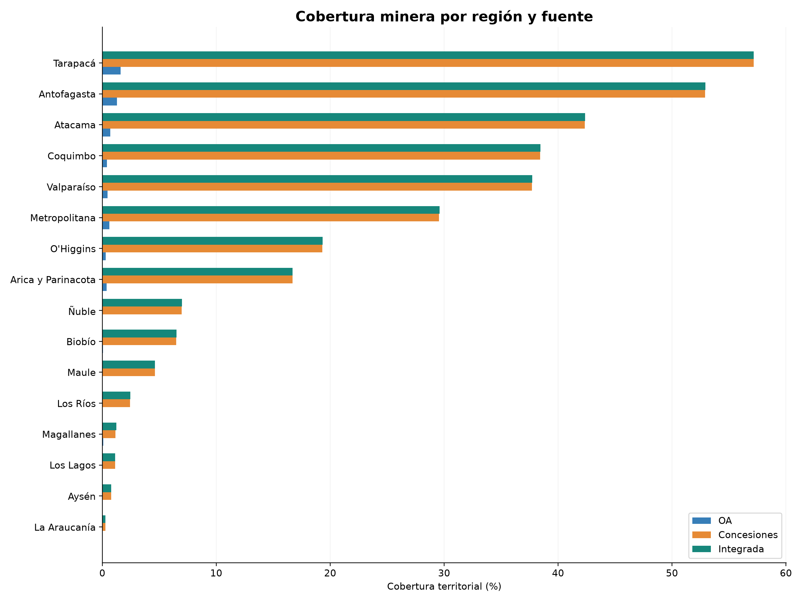
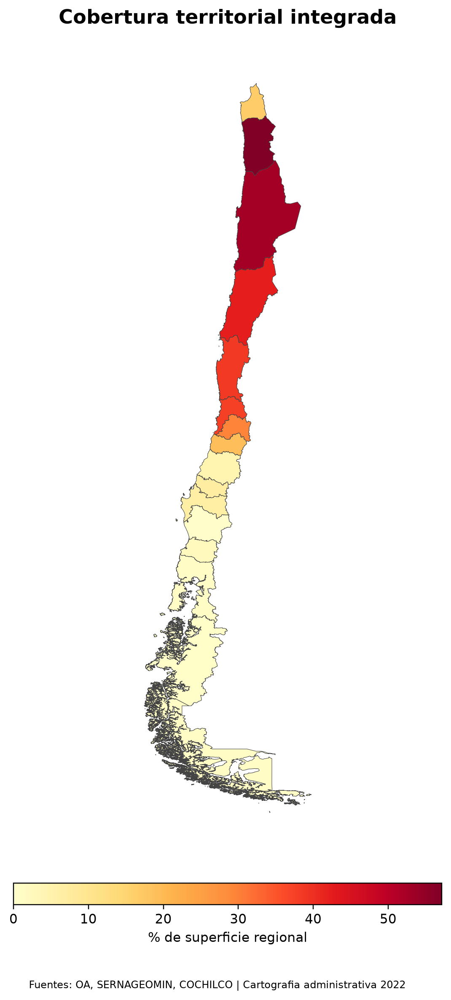
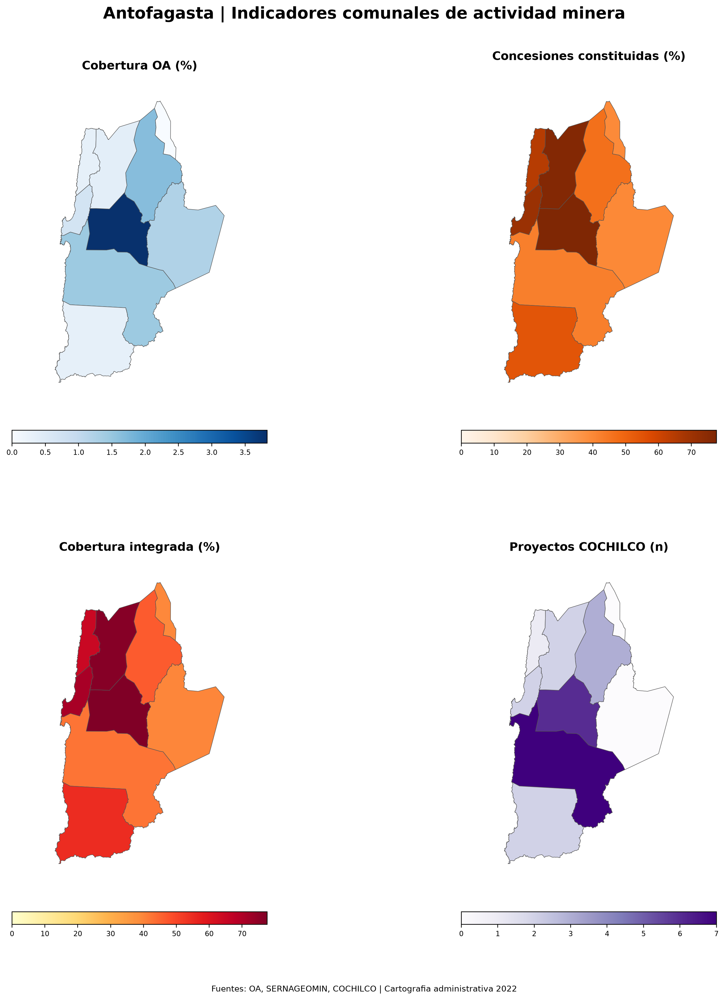
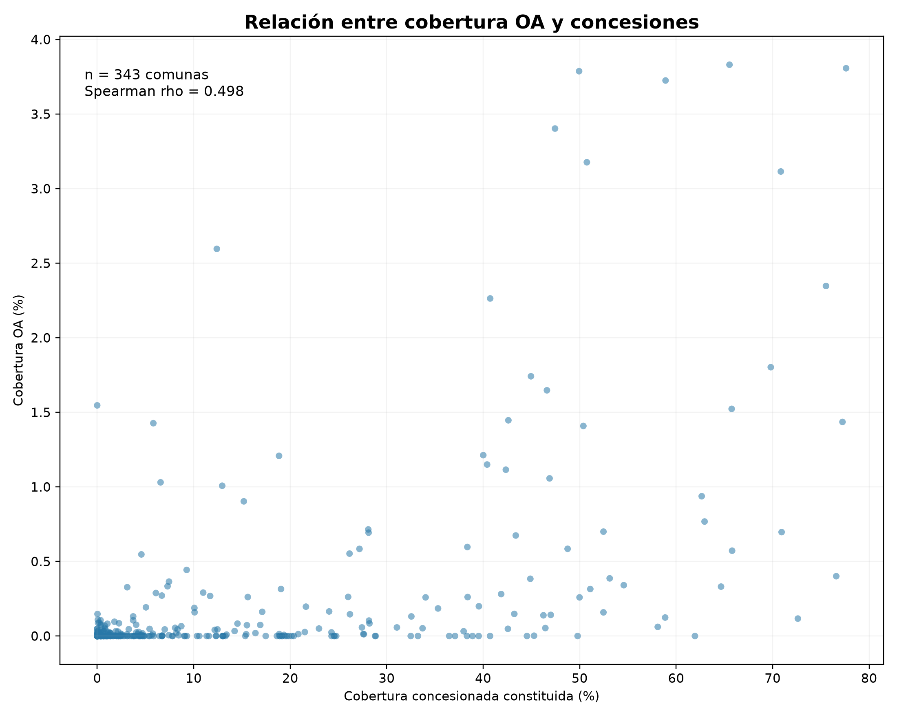
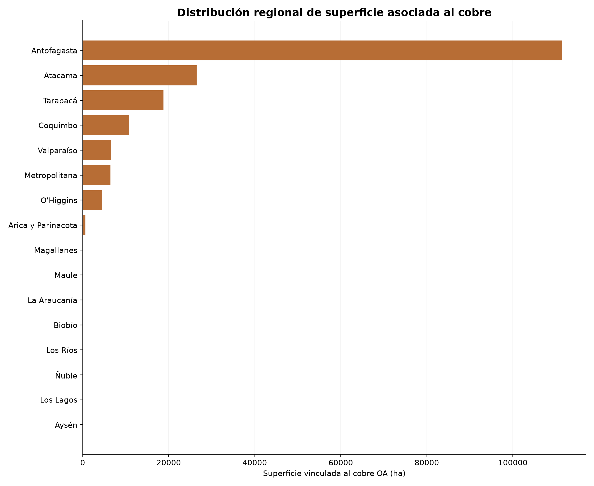
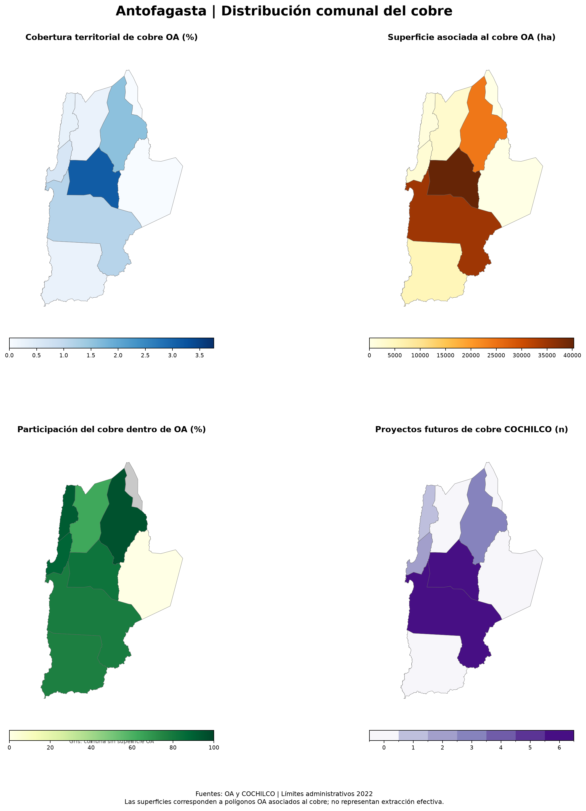
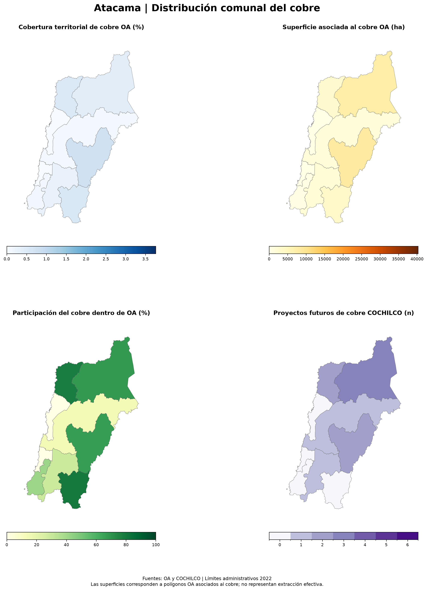
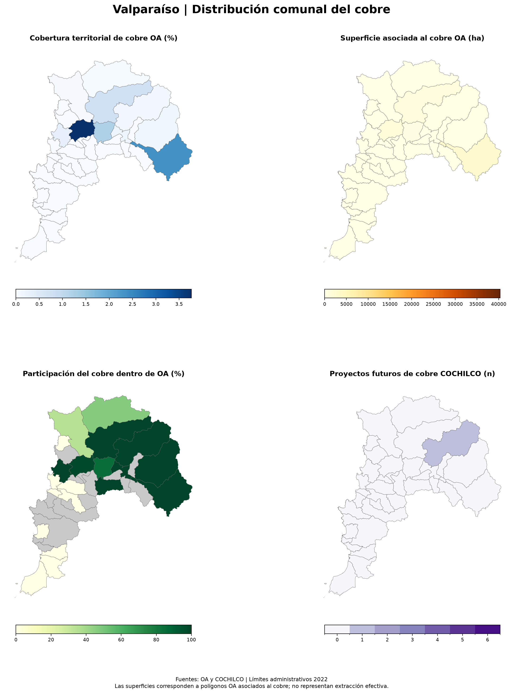
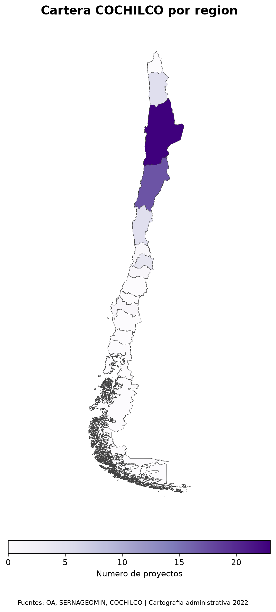

# Atlas estadístico de actividad minera en Chile

**Informe de principales hallazgos territoriales**  
**Escala:** nacional, regional y comunal · **Cobertura:** 16 regiones y 343 comunas · **Versión:** octubre de 2026

> **Alcance.** Este documento examina la distribución territorial de polígonos de actividad minera del Observatorio Ambiental (OA), concesiones mineras constituidas de SERNAGEOMIN y puntos de proyectos de la cartera COCHILCO. **Las coberturas son indicadores espaciales de presencia o registro, no hectáreas efectivamente explotadas ni superficie de impacto ambiental.**

## Resumen ejecutivo

La combinación de las tres fuentes permite distinguir entre **superficie asociada a proyectos mineros**, **derechos de concesión constituidos** y **ubicaciones de proyectos de inversión**. Las principales conclusiones son:

1. **Amplia extensión de las concesiones constituidas.** Cubren **16.239.454 ha**, equivalentes al **21,58 %** de los **75.256.754 ha** de territorio administrativo de referencia. La cobertura espacial integrada de OA y concesiones alcanza **16.257.709 ha (21,60 %)**.
2. **La mayoría de la superficie OA se encuentra dentro de concesiones.** De **343.699 ha OA**, **325.444 ha** coinciden espacialmente con concesiones constituidas (**94,69 %**). La superficie exclusivamente OA asciende a **18.255 ha** y añade aproximadamente **0,024 puntos porcentuales** a la cobertura territorial nacional respecto de las concesiones consideradas de forma aislada.
3. **Fuerte heterogeneidad regional.** Tarapacá (**57,17 %**), Antofagasta (**52,92 %**) y Atacama (**42,38 %**) registran las mayores proporciones de cobertura integrada en su respectivo territorio administrativo.
4. **Concentración territorial del cobre OA.** Se identifican **185.695 ha** asociadas al cobre en **53 comunas**, equivalentes al **54,03 %** de la superficie OA nacional. Antofagasta concentra **111.419 ha**, aproximadamente **60,0 %** del total de cobre OA; junto con Atacama y Tarapacá reúne **84,39 %**.
5. **Asociación estadística moderada.** La relación comunal entre porcentaje de superficie concesionada y porcentaje OA presenta **ρ de Spearman = 0,4982** (343 comunas). Describe una asociación monotónica positiva, sin demostrar causalidad ni equivalencia entre ambas capas.
6. **Cartera futura territorialmente concentrada.** Se localizaron **57 proyectos COCHILCO**, de los cuales **40** se clasifican como cobre (**70,18 %**). Antofagasta cuenta con **23 proyectos**, incluidos **18 de cobre**; Atacama, con **17 proyectos**, incluidos **9 de cobre**.

---

## 1. Cobertura minera: concesiones, OA e integración

| Indicador nacional | Superficie (ha) | % del territorio de referencia |
|---|---:|---:|
| Concesiones constituidas (unión sin doble conteo) | 16.239.454 | 21,58 % |
| Polígonos OA (unión sin doble conteo) | 343.699 | 0,46 % |
| Intersección OA ∩ concesiones constituidas | 325.444 | 0,43 % |
| OA fuera de concesiones constituidas | 18.255 | 0,024 % |
| **Cobertura integrada OA ∪ concesiones** | **16.257.709** | **21,60 %** |

La diferencia entre la superficie total OA y su contribución exclusiva ilustra por qué no deben sumarse las coberturas de fuentes que se superponen. Aunque OA y concesiones tienen propósitos y atributos diferentes, **su coincidencia espacial es elevada**. En términos de superficie agregada, incorporar OA añade una proporción relativamente pequeña a la unión, sin que ello reste valor a los atributos específicos de OA para describir proyectos o minerales.

*Figura 1. Porcentaje de superficie regional cubierto por cada fuente y su unión espacial. OA y concesiones no son categorías mutuamente excluyentes.*

### Diferencias regionales

La mayor cobertura integrada relativa se observa en **Tarapacá (57,17 %)**, **Antofagasta (52,92 %)** y **Atacama (42,38 %)**, seguidas por Coquimbo (38,44 %) y Valparaíso (37,73 %). Estos porcentajes comparan la superficie cubierta con el área de cada región; **no equivalen a porcentaje de explotación minera**.

*Figura 2. Cobertura integrada OA–concesiones constituidas como porcentaje de superficie regional.*

*Figura 3. Antofagasta: cuatro indicadores comunales que evidencian la concentración territorial y la variabilidad dentro de una misma región.*

## 2. Relación entre OA y concesiones a escala comunal

El análisis exploratorio de **343 comunas** arroja una **correlación de Spearman de 0,4982** entre las coberturas porcentuales comunales de OA y concesiones constituidas. La magnitud es compatible con una **asociación positiva moderada**: comunas con mayor cobertura concesionada tienden a mostrar también una mayor cobertura OA, aunque con dispersión apreciable.

*Figura 4. Relación entre coberturas porcentuales comunales. ρ = 0,4982 es una estadística descriptiva y no implica causalidad.*

**Lectura adecuada:** los indicadores se calculan sobre la misma unidad territorial y comparten parte del espacio, lo que contribuye a su asociación. Una correlación de rangos no cuantifica por sí sola concordancia geométrica, por lo que debe leerse junto con los resultados de intersección y unión espacial.

## 3. Cobre: concentración regional y comunal

Se identificaron **185.694,67 ha OA vinculadas al cobre**, de las cuales **173.352,52 ha** corresponden a registros de cobre exclusivo y **12.342,15 ha** a cobre asociado con otros minerales. El total se calculó sin doble conteo espacial.

| Región | Superficie cobre OA (ha) | % del cobre OA nacional | Proyectos COCHILCO de cobre (n) |
|---|---:|---:|---:|
| Antofagasta | 111.419 | 60,00 % | 18 |
| Atacama | 26.481 | 14,26 % | 9 |
| Tarapacá | 18.809 | 10,13 % | 4 |
| Coquimbo | 10.769 | 5,80 % | 4 |
| Valparaíso | 6.624 | 3,57 % | 1 |
| Metropolitana | 6.463 | 3,48 % | 3 |
| O'Higgins | 4.472 | 2,41 % | 1 |

*Se muestran las siete regiones con mayor superficie OA vinculada al cobre; cifras redondeadas. El número de proyectos es un conteo de puntos COCHILCO, no de hectáreas.*

*Figura 5. Concentración territorial del cobre OA. Antofagasta, Atacama y Tarapacá acumulan aproximadamente 84,39 % del total nacional analizado.*

### Comunas con mayor superficie OA asociada al cobre

| Comuna | Región | Cobre OA (ha) | % de la superficie comunal |
|---|---|---:|---:|
| Sierra Gorda | Antofagasta | 40.326 | 3,13 % |
| Antofagasta | Antofagasta | 34.740 | 1,13 % |
| Calama | Antofagasta | 24.401 | 1,57 % |
| Pica | Tarapacá | 16.203 | 1,80 % |
| Tierra Amarilla | Atacama | 8.401 | 0,75 % |
| Diego de Almagro | Atacama | 7.549 | 0,40 % |

Las tres primeras comunas pertenecen a Antofagasta. La cobertura comunal permite diferenciar **volumen absoluto de superficie** y **peso relativo dentro del territorio**: no siempre las comunas con más hectáreas presentan el mayor porcentaje.

*Figura 6. Antofagasta: cobertura comunal de cobre OA, hectáreas de cobre, participación del cobre dentro de OA y proyectos futuros COCHILCO de cobre.*

*Figura 7. Atacama: heterogeneidad entre comunas y presencia de proyectos futuros de cobre.*

*Figura 8. Valparaíso: patrón territorial localizado del cobre OA. Los mapas utilizan escalas nacionales comunes; tonos claros no significan necesariamente ausencia.*

## 4. Cartera COCHILCO: presencia territorial, no superficie

Los **57 proyectos COCHILCO** analizados fueron asignados espacialmente a comunas; **40 corresponden a cobre**. La concentración es notable en el norte: Antofagasta reúne 23 proyectos y Atacama 17, equivalentes en conjunto a **40 de los 57** proyectos considerados. De los 57 puntos, **35** coinciden con geometrías OA, **52** se ubican dentro de concesiones constituidas y **34** coinciden con ambas fuentes.

*Figura 9. Número de proyectos COCHILCO por región. Los conteos corresponden a puntos localizados y no deben interpretarse como superficies de proyecto.*

La ubicación de un punto dentro de un polígono es una **coincidencia espacial**, no prueba por sí misma propiedad, vínculo administrativo, titularidad de concesión o relación causal.

## 5. Implicaciones para el observatorio y análisis posteriores

La base integrada permite construir al menos cuatro líneas de seguimiento: (i) indicadores comparables entre regiones y comunas; (ii) identificación de áreas OA ubicadas fuera de concesiones constituidas; (iii) análisis territorial focalizado en minerales, especialmente cobre; y (iv) comparación entre presencia espacial de proyectos y cartera de inversión. Estas líneas son **aplicaciones posibles de los resultados**, no conclusiones sobre impactos, producción ni cumplimiento regulatorio.

Para profundizar se recomienda complementar las capas con estado de operación, períodos de vigencia, polígonos efectivos de faena, inversión, producción y variables ambientales, siempre que las fuentes dispongan de información adecuada y sus condiciones de uso lo permitan.

## 6. Metodología y limitaciones

- **Unidad de análisis:** 343 comunas consolidadas en 16 regiones, sobre cartografía administrativa de referencia 2022.
- **Superficie de referencia:** 75.256.754,28 ha. Los porcentajes dependen del recorte, la versión de límites y la proyección utilizada.
- **Cálculos:** reproyección a **EPSG:6933**, reparación de geometrías inválidas cuando fue necesario, intersecciones y uniones espaciales para evitar doble conteo, y agregación comunal y regional.
- **Concesiones:** se consideran las clasificadas como **constituidas** en el insumo SERNAGEOMIN utilizado; una concesión no equivale a actividad extractiva ni a impacto ambiental efectivo.
- **OA:** los polígonos se consideran indicadores de presencia de registros de actividad/proyectos mineros de esa fuente. La etiqueta “cobre asociado” no supone que toda la superficie se destine exclusivamente a extraer cobre.
- **COCHILCO:** los proyectos se representan mediante puntos; los conteos dependen de la ubicación de referencia registrada.
- **Valores nulos:** cuando una comuna carece de superficie OA, el porcentaje de cobre dentro de OA es **no aplicable**, no 0 %.
- **Correlación:** Spearman es descriptiva, calculada entre coberturas comunales, sin ajuste por variables de confusión, autocorrelación espacial ni pruebas de significación aquí reportadas.
- **Disponibilidad:** los insumos originales se excluyen de este repositorio; la ejecución integral de scripts requiere obtenerlos por separado y respetar sus condiciones de reutilización. Los resultados derivados deben revisarse conforme a dichas condiciones antes de difusión pública.

## 7. Archivos de referencia del proyecto

**Matrices principales:**

- [`matriz_mineria_comunal_v1.csv`](../outputs/tables/matriz_mineria_comunal_v1.csv)
- [`matriz_mineria_regional_v1.csv`](../outputs/tables/matriz_mineria_regional_v1.csv)
- [`matriz_cobre_comunal_v1.csv`](../outputs/tables/matriz_cobre_comunal_v1.csv)
- [`matriz_cobre_regional_v1.csv`](../outputs/tables/matriz_cobre_regional_v1.csv)
- [`atlas_estadisticas_descriptivas.csv`](../outputs/tables/atlas_estadisticas_descriptivas.csv)

**Galerías:**

- [Mapas comunales por región](../outputs/maps/regionales_comunas/)
- [Mapas comunales de cobre](../outputs/maps/regionales_cobre/)
- [Figuras estadísticas del atlas](../outputs/figures/atlas/)

**Metodología ampliada:** [`methodology.md`](methodology.md) · **Diccionario de campos:** [`data_dictionary.md`](data_dictionary.md).

---

**Nota editorial:** las cifras están redondeadas para lectura. Los archivos CSV conservan valores de mayor precisión. El informe documenta resultados del procesamiento disponible y no constituye evaluación de impacto ambiental ni certificación del estado legal de cada proyecto.
